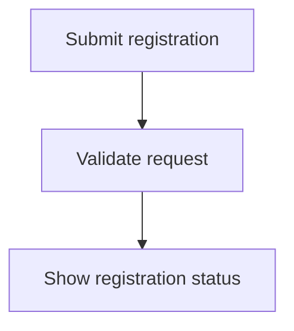

# PR description style

Base the description on the actual source-to-target diff and useful confirmed issue/plan context. Explain the final result to a reviewer who has not seen the chat. Avoid file-by-file narration, implementation trivia, abandoned approaches, hype, invented metrics, and unsupported behavior.

Use this order, adapting to required repository template fields:

1. **Opening:** no heading, roughly 100–300 characters stating what changed and why it matters. Lead with the concrete problem and resulting behavior.
2. **How it works:** `## How it works`, with a short numbered list for sequential behavior or bullets for independent concepts. At most ten items; this limit applies to the PR explanation, not implementation checkpoints.
3. **Flows:** include `## Flows` only when a diagram adds clarity. Use one small Mermaid chart per use case, each in a GitHub `<details>` block with a descriptive `<summary>`. Prefer `flowchart TD` or `flowchart LR`. Do not squeeze several journeys into one large chart.
4. **How to test the change:** include only when `--test-plan` or `test-plan=true` was requested. Give short practical reviewer/QA steps and observable expected results. Suggested steps must not imply they were executed.
5. **Verification:** briefly report actual checks/results and material limitations when relevant. Keep this distinct from optional instructions for the reviewer; never claim tests passed from a plan alone.
6. **Issue (optional):** when an issue was supplied and verified, include `Closes #<verified issue number>` for complete scope in the same repository, or the verified full issue URL where needed. Automatic closure requires merging into the repository's default branch. Use a non-closing reference for intentional partial delivery. Omit this section when no issue is associated; do not invent or require a ticket.

Example flow block (replace the example with the actual use case):

````markdown
## Flows

<details>
<summary>Participant submits a registration</summary>



</details>
````

Use short, plain sentences and the project's product language. Avoid mid-phrase dashes and semicolons as connectors. Include technical detail only where it helps review the behavior or a meaningful tradeoff. Scale length to the change.

Publish raw Markdown with normal inner Mermaid/code fences. The outer example fence above is only for displaying the example, not part of the PR body. If offering a copyable chat preview, its enclosing fence must be longer than every inner fence.
