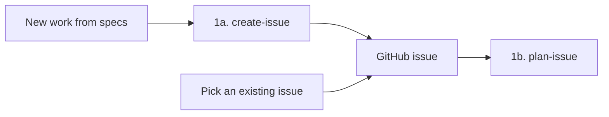
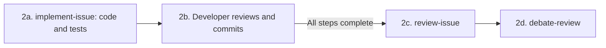
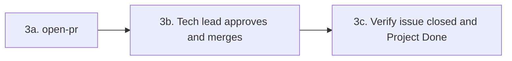

# Karlbrüder

**Created**: 2023-03-24
**Last updated**: 2026-10-31

Monorepo for the Karlbrüder public website and tournament platform. Association membership and equipment inventory are future capabilities.

## Repository map

| Directory or file | Responsibility | Setup |
| --- | --- | --- |
| `landing/` | Public React website at `karlbruder.com.br` | [Landing README](landing/README.md) |
| `frontend/` | React/TypeScript/Vite application, intended for `app.karlbruder.com` | [Frontend README](frontend/README.md) |
| `backend/` | FastAPI API, Supabase token verification, and domain PostgreSQL access | [Backend README](backend/README.md) |
| `compose.yml` | Local landing, frontend, backend, and PostgreSQL. Backend source reloads on change | Local setup below |
| `Makefile` | Short commands for local Compose, the database script, and checks | `make help` |
| `compose.test.yml` | Isolated backend tests. No published ports | [Backend tests](backend/README.md#tests-and-lint) |
| `compose.prod.yml` | Production Nginx, frontend, and backend | Production direction below |
| `specs/` | Intended product behavior, architecture, decisions, and open questions | [Specification index](specs/README.md) |
| `docs/aws.md` | How the team signs in to the AWS account | [AWS](docs/aws.md) |
| `docs/runbooks/` | Operational procedures as they are implemented and verified | [Runbook index](docs/runbooks/README.md) |

Coding agents must follow [AGENTS.md](AGENTS.md) and applicable nested instructions. Specifications describe intended behavior. The current application includes Google sign-in/session handling, backend identity verification, health checks, a Monomachia registration route, and a tournament sign-up API. The registration flow still needs live browser acceptance; payment proofs, results, membership, and inventory are not implemented yet.

## Agentic development

Start from [specifications](specs/README.md) or pick an existing GitHub issue. Invoke the linked skills in your agent chat using `$skill-name` in Codex or `/skill-name` in Claude Code and Cursor. GitHub actions use your own authenticated GitHub CLI account.

### 1. Pick an issue and plan it

The tech lead or developer can use [create-issue](.agents/skills/create-issue/SKILL.md) to clarify a delivery slice from the specs and publish it after approval. **If the issue already exists, pick it from GitHub and start with [plan-issue](.agents/skills/plan-issue/SKILL.md)**, for example `$plan-issue 123`. Review the saved plan before implementation.



### 2. Implement, review, and address findings

Run [implement-issue](.agents/skills/implement-issue/SKILL.md), for example `$implement-issue 123`. It creates or resumes the issue branch and moves the Project item to **In Progress** when work starts. Each step includes its tests. **You review, stage, and commit**; the agent suggests a message and waits for your permission before the next step.



Repeat 2a–2b for every planned step. Then run [review-issue](.agents/skills/review-issue/SKILL.md) to produce findings and runnable probes, and [debate-review](.agents/skills/debate-review/SKILL.md) to assess them skeptically. Pass the review path to the debating agent. You choose which fixes matter; return to 2a–2b for those fixes and recheck the affected findings.

### 3. Open the PR and finish

Run [open-pr](.agents/skills/open-pr/SKILL.md), for example `$open-pr 123`. It publishes the committed branch, opens the PR, and moves the linked issue's Project item to **In Review**, whether it was To Do or In Progress. Branch-only PRs without an associated issue skip the Project update.



Tech-lead change requests return to step 2. For completed issue scope, the PR includes `Closes #123`, which [closes the issue when merged into the default branch](https://docs.github.com/en/issues/tracking-your-work-with-issues/using-issues/linking-a-pull-request-to-an-issue). After merge into `master`, verify closure and mark the Project item Done if automation has not done so. Failed Project updates are reported for manual follow-up.

Issue numbers can be replaced with URLs. Review, debate, and PR skills also accept `--source feature/example --target master` without an issue or plan; debate still needs review feedback. Creation, planning, and implementation stay issue-driven.

Plans, checkpoint state, reviews, and probes are saved under Git-ignored `.local/`. Plans are versioned; review/debate folders use `issue-<number>/` or `<target>__<source>/`. Pass the saved paths to resume in a new chat. Local files are not shared through GitHub, so keep issues and PRs self-contained.

## Local setup with Docker Compose

Install Git and Docker with Docker Compose. Host Python, Poetry, Node.js, and PostgreSQL are unnecessary for the containerized services.

Each application has its own environment file. Compose reads that file for the matching service. There is no application environment file at the repository root.

From the repository root, create the local files:

```sh
cp backend/.env.example backend/.env
cp frontend/.env.example frontend/.env
cp landing/.env.example landing/.env
```

On PowerShell, use `Copy-Item` in place of `cp` if needed. Fill in:

| File | Variable | Use |
| --- | --- | --- |
| `backend/.env` | `ENV_NAME` | `local` for Compose. Any other name uses AWS settings and requires `SECRET_NAME`. |
| `backend/.env` | `DB_HOST`, `DB_PORT`, `DB_NAME`, `DB_USER`, `DB_PASSWORD` | Local Compose uses host `db`, database `postgres`, user `postgres`, and password `postgres`. A host-run backend uses `localhost` instead of `db`. |
| `backend/.env` | `SUPABASE_URL` | Hosted Supabase HTTPS project root for backend token verification. |
| `backend/.env` | `AUTH_DB_*` | PostgreSQL connection used by `/health/auth`. Sign-in and token verification use `SUPABASE_URL` instead. |
| `frontend/.env` | `VITE_SUPABASE_URL` | The same hosted Supabase project root. |
| `frontend/.env` | `VITE_SUPABASE_ANON_KEY` | The project's public client/anon key, as read by the current frontend. |
| `landing/.env` | `REACT_APP_APPLICATION_URL` | Origin of the private application. Local development uses `http://localhost:5173`. |

`compose.prod.yml` reads `backend/.env` on the server. It does not run the landing site. Configure the hosted project's Google sign-in and allowed frontend origin for `http://localhost:5173`.

Start the local services:

```sh
make up
```

`make help` lists the other local commands. `make up` runs `docker compose up --build`.

| Service | Address or connection |
| --- | --- |
| Public website | `http://localhost:3000` |
| Frontend development server | `http://localhost:5173` |
| Backend API and Swagger UI | `http://localhost:8000/docs` |
| Backend liveness | `http://localhost:8000/health` |
| Domain database diagnostic | `http://localhost:8000/health/db` |
| Optional Auth database diagnostic | `http://localhost:8000/health/auth` |
| Protected identity endpoint | `http://localhost:8000/api/users/me` with a Bearer access token |
| Local PostgreSQL | `localhost:5432`, database `postgres`, user `postgres`, password `postgres` |

The sample database credentials are local development defaults. `backend/.env` points Compose at host `db`, database `postgres`, user `postgres`, and password `postgres`. The hostname `db` works inside Compose. Host-run tools use `localhost`. Local domain data is independent from hosted Supabase data. Authentication uses hosted Supabase in either environment.

Backend source is bind-mounted, and Uvicorn reloads when those files change. Frontend and landing mount their source trees, so edits there reload as well. `node_modules` and the Python packages stay in the image. Rebuild and recreate a service after a dependency change, or after that service's environment file changes:

```sh
make recreate-backend
make recreate-frontend
make recreate-landing
```

Stop services and remove the local network with:

```sh
make down
```

The PostgreSQL volume is retained. `make down-volumes` deletes that local database volume.

## Current local integration notes and gaps

The Compose frontend health check probes Vite at `localhost:5173`. Browser requests to `/api` on the frontend origin use Vite's proxy to reach the backend with the `/api` prefix intact. The frontend image's Nginx configuration also preserves that prefix when the image is used; local Compose uses Vite instead of that Nginx image stage.

These source-observed limitations remain, without changing the working same-origin `/api` path:

- Backend CORS currently allows `http://localhost:3000` as its explicit origin. Direct browser requests from `http://localhost:5173` to `http://localhost:8000` are outside that allowlist; use the frontend's same-origin `/api` path for local application calls.
- `Home.tsx` and `Health.tsx` exist, but `App.tsx` does not mount their routes. `/health` on the frontend is not a working diagnostics screen; use the direct backend endpoints above.

Backend container health checks exercise the domain database via `/health/db`; liveness alone does not verify connectivity or application schema migrations. A failed Auth database connection makes `/health/auth` return 503 without disabling token verification. See [local development](specs/platform/local-development.md) for the remaining platform gaps.

## Application development and checks

Run commands in the relevant application's directory. Each application has its own lockfile. This repository is not an npm workspace.

- [Backend](backend/README.md): host configuration, authentication smoke test, pytest, and Ruff.
- [Frontend](frontend/README.md): Supabase settings, Vite, build, and ESLint scripts.
- [Landing](landing/README.md): public routes, content, build, and React tests.

## Production direction

Production Compose is `compose.prod.yml`. It runs Nginx, the built frontend, and the backend. Nginx publishes port 443 and creates a self-signed certificate on first start. Frontend and backend ports stay on the Compose network. Putting that stack on EC2 and pointing Cloudflare at it is still separate work.

Cloudflare provides DNS, public TLS, and the HTTP-to-HTTPS redirect. Its proxied application A record targets the EC2 Elastic IP. Cloudflare uses Full mode to reach the self-signed Nginx origin over HTTPS 443. Only Nginx publishes an application host port. It preserves `/api` when forwarding to the backend and sends other application requests to the frontend.

Domain records use hosted Supabase PostgreSQL's `public` schema, with no production PostgreSQL container; Supabase manages `auth`. Private files will use S3, with Ministack locally when storage is implemented. Application email will use AWS SES via SMTP; local SMTP setup remains deferred. Credentials belong in environment/secrets configuration, never frontend bundles.

The public landing site is separate. Its existing workflows build and deploy static assets to S3; their existence does not verify live DNS, account migration, or deployment health. See [architecture](specs/architecture.md), [deployment](specs/platform/deployment.md), and the [landing workflow documentation](landing/README.md#continuous-integration-and-deployment).
