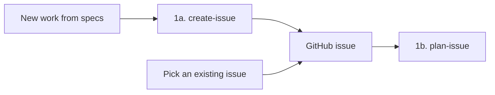
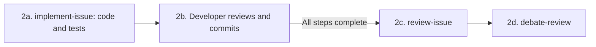
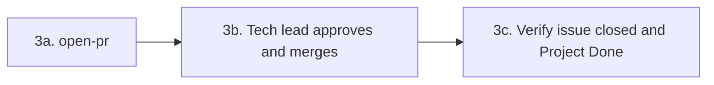

# Karlbrüder

Monorepo for the Karlbrüder public website and tournament platform. Association membership and equipment inventory are future capabilities.

## Repository map

| Directory or file | Responsibility | Setup |
| --- | --- | --- |
| `landing/` | Public React website at `karlbruder.com.br` | [Landing README](landing/README.md) |
| `frontend/` | React/TypeScript/Vite application, intended for `app.karlbruder.com` | [Frontend README](frontend/README.md) |
| `backend/` | FastAPI API, Supabase token verification, and domain PostgreSQL access | [Backend README](backend/README.md) |
| `compose.yml` | Local frontend, backend, and PostgreSQL services | Local setup below |
| `specs/` | Intended product behavior, architecture, decisions, and open questions | [Specification index](specs/README.md) |
| `docs/runbooks/` | Operational procedures as they are implemented and verified | [Runbook index](docs/runbooks/README.md) |

Coding agents must follow [AGENTS.md](AGENTS.md) and applicable nested instructions. Specifications describe intended behavior; the current application implements Google sign-in/session handling, backend identity verification, and health checks. Tournament registration, payment proofs, results, membership, and inventory are not implemented yet.

## Agentic development

Start from [specifications](specs/README.md) or pick an existing GitHub issue. Invoke the linked skills in your agent chat using `$skill-name` in Codex or `/skill-name` in Claude Code and Cursor. GitHub actions use your own authenticated GitHub CLI account.

### 1. Pick an issue and plan it

The tech lead or developer can use [create-issue](.agents/skills/create-issue/SKILL.md) to clarify a delivery slice from the specs and publish it after approval. **If the issue already exists, pick it from GitHub and start with [plan-issue](.agents/skills/plan-issue/SKILL.md)**, for example `$plan-issue 123`. Review the saved plan before implementation.



### 2. Implement, review, and address findings

Run [implement-issue](.agents/skills/implement-issue/SKILL.md), for example `$implement-issue 123`. It creates or resumes the issue branch and moves the Project item to **In Progress** when work starts. Each step includes its tests. **You review, stage, and commit**; the agent suggests a message and waits for your permission before the next step.



Repeat 2a–2b for every planned step. Then run [review-issue](.agents/skills/review-issue/SKILL.md) to produce findings and runnable probes, and [debate-review](.agents/skills/debate-review/SKILL.md) to assess them skeptically. Pass the review path to the debating agent. You choose which fixes matter; return to 2a–2b for those fixes and recheck the affected findings.

### 3. Open the PR and finish

Run [open-pr](.agents/skills/open-pr/SKILL.md), for example `$open-pr 123`. It publishes the committed branch, opens the PR, and moves the linked issue's Project item to **In Review**, whether it was To Do or In Progress. Branch-only PRs without an associated issue skip the Project update.



Tech-lead change requests return to step 2. For completed issue scope, the PR includes `Closes #123`, which [closes the issue when merged into the default branch](https://docs.github.com/en/issues/tracking-your-work-with-issues/using-issues/linking-a-pull-request-to-an-issue). After merge into `master`, verify closure and mark the Project item Done if automation has not done so. Failed Project updates are reported for manual follow-up.

Issue numbers can be replaced with URLs. Review, debate, and PR skills also accept `--source feature/example --target master` without an issue or plan; debate still needs review feedback. Creation, planning, and implementation stay issue-driven.

Plans, checkpoint state, reviews, and probes are saved under Git-ignored `.local/`. Plans are versioned; review/debate folders use `issue-<number>/` or `<target>__<source>/`. Pass the saved paths to resume in a new chat. Local files are not shared through GitHub, so keep issues and PRs self-contained.

## Local setup with Docker Compose

Install Git and Docker with Docker Compose. Host Python, Poetry, Node.js, and PostgreSQL are unnecessary for these three containerized services. Running the landing site separately requires Node.js and npm.

From the repository root, create your local configuration files:

```sh
cp .env.example .env
cp frontend/.env.example frontend/.env
```

On PowerShell, use `Copy-Item` in place of `cp` if needed. Fill in:

| File | Variable | Use |
| --- | --- | --- |
| `.env` | `DATABASE_URL` | Leave blank for Compose's local PostgreSQL default. Set an explicit URI only when intentionally using another domain database. |
| `.env` | `SUPABASE_URL` | Hosted Supabase HTTPS project root for backend token verification. |
| `.env` | `AUTH_DATABASE_URL` | Optional hosted PostgreSQL URI, used only by `/health/auth`. It is unnecessary for sign-in or token verification. |
| `frontend/.env` | `VITE_SUPABASE_URL` | The same hosted Supabase project root. |
| `frontend/.env` | `VITE_SUPABASE_ANON_KEY` | The project's public client/anon key, as read by the current frontend. |

Root `.env` values are supplied to backend containers by Compose. Vite reads the separate `frontend/.env`; the root file does not configure browser code. Configure the hosted project's Google sign-in and allowed frontend origin for `http://localhost:5173`.

Start the local services:

```sh
docker compose up --build
```

| Service | Address or connection |
| --- | --- |
| Frontend development server | `http://localhost:5173` |
| Backend API and Swagger UI | `http://localhost:8000/docs` |
| Backend liveness | `http://localhost:8000/health` |
| Domain database diagnostic | `http://localhost:8000/health/db` |
| Optional Auth database diagnostic | `http://localhost:8000/health/auth` |
| Protected identity endpoint | `http://localhost:8000/api/users/me` with a Bearer access token |
| Local PostgreSQL | `127.0.0.1:5432`, database `kb-db`, user `user`, password `password` |

The sample database credentials are local development defaults. With blank or absent `DATABASE_URL`, Compose injects `postgresql://user:password@db:5432/kb-db`. The hostname `db` works inside Compose; host-run tools use `127.0.0.1`. Local domain data is independent from hosted Supabase data. Authentication uses hosted Supabase in either environment.

After changing root backend configuration, recreate the backend:

```sh
docker compose up -d --force-recreate backend
```

Restart the frontend development server after changing its environment file. Backend source changes require an image rebuild with the current Compose configuration; the frontend uses a source bind mount for development.

Stop services and remove the local network with:

```sh
docker compose down
```

The PostgreSQL volume is retained. Adding `-v` deletes that local database volume.

## Current local integration gaps

These are source-observed limitations, not additional product decisions:

- The frontend runs Vite on 5173, but its Compose health check targets port 80. It may be reported unhealthy even when Vite responds.
- Vite has no `/api` proxy, and backend CORS currently allows only `http://localhost:3000`. End-to-end API requests from the default frontend origin are not configured yet.
- `Home.tsx` and `Health.tsx` exist, but `App.tsx` does not mount their routes. `/health` on the frontend is not a working diagnostics screen; use the direct backend endpoints above.
- The frontend image's Nginx config strips `/api/`, which conflicts with the intended prefix-preserving routing contract. Local Compose uses Vite, not that Nginx image stage.

Backend container health checks exercise the domain database via `/health/db`; liveness alone does not verify connectivity or application schema migrations. A missing optional `AUTH_DATABASE_URL` makes `/health/auth` return 503 without disabling token verification. See [local development](specs/platform/local-development.md) for the implementation follow-up.

## Application development and checks

Run commands in the relevant application's directory. Use its own lockfile; the root lockfile is not an npm workspace setup.

- [Backend](backend/README.md): host configuration, authentication smoke test, pytest, and Ruff.
- [Frontend](frontend/README.md): Supabase settings, Vite, build, and ESLint scripts.
- [Landing](landing/README.md): public routes, content, build, and React tests.

## Production direction

The selected production stack is `compose.prod.yml` on EC2 with separate Nginx, frontend, and backend containers. **That file and the complete production application deployment are not implemented in this checkout.**

Cloudflare provides DNS, public TLS, and the HTTP-to-HTTPS redirect. Its proxied application A record targets the EC2 Elastic IP. Cloudflare uses Full mode to reach the self-signed Nginx origin over HTTPS 443. Only Nginx publishes an application host port. It preserves `/api` when forwarding to the backend and sends other application requests to the frontend.

Domain records use hosted Supabase PostgreSQL's `public` schema, with no production PostgreSQL container; Supabase manages `auth`. Private files will use S3, with Ministack locally when storage is implemented. Application email will use AWS SES via SMTP; local SMTP setup remains deferred. Credentials belong in environment/secrets configuration, never frontend bundles.

The public landing site is separate. Its existing workflows build and deploy static assets to S3; their existence does not verify live DNS, account migration, or deployment health. See [architecture](specs/architecture.md), [deployment](specs/platform/deployment.md), and the [landing workflow documentation](landing/README.md#continuous-integration-and-deployment).
