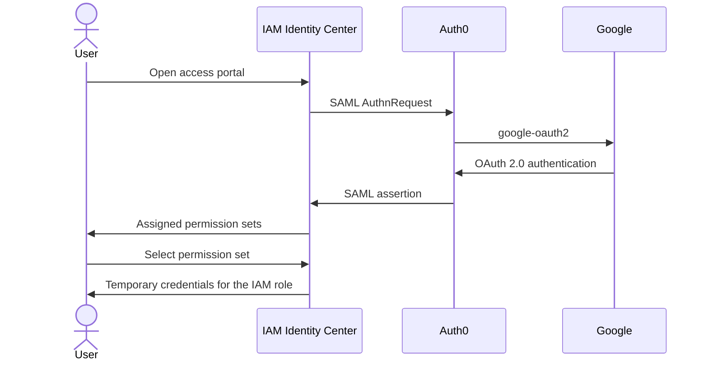

# AWS team access

**Created**: 2026-10-31
**Last updated**: 2026-11-04

Team access to the Karlbrüder AWS account is workforce SSO through IAM Identity Center. The access portal is the service-provider entry point.

https://karlbruder.awsapps.com/start/#/

Application users authenticate with Supabase. That identity domain is separate from this federation. Required team-access policy lives in the [team-access spec](../specs/platform/team-access.md). GitHub deployment credentials are covered by the [access runbook](runbooks/github-actions-access.md).

## Federation

IAM Identity Center is the SAML 2.0 service provider. Auth0 is the SAML identity provider. Trust is the Auth0 IdP metadata for tenant `dev-a7mummq46bfsiv0z`.

https://manage.auth0.com/dashboard/us/dev-a7mummq46bfsiv0z/applications

Auth0 is an identity broker in this flow. It authenticates the user with the Google social connection `google-oauth2` (OAuth 2.0) and issues the SAML assertion Identity Center accepts. Google is the upstream identity provider. Identity Center does not federate with Google directly.

Authentication and authorization are separate. A valid assertion identifies the user. Account access exists only when that user has an Identity Center account assignment.

## Sign-in

Identity Center matches the assertion to a directory user, then lists the permission sets assigned to that user on this account. Selecting one returns temporary credentials for the IAM role provisioned from that permission set.

## Permission sets

| Permission set | Access |
| --- | --- |
| `AdministratorAccess` | Full access to AWS services and resources |
| `PowerUserAccess` | Full access to AWS services and resources, excluding IAM user and group administration |
| `ReadOnlyAccess` | Read-only access to AWS services and resources |
