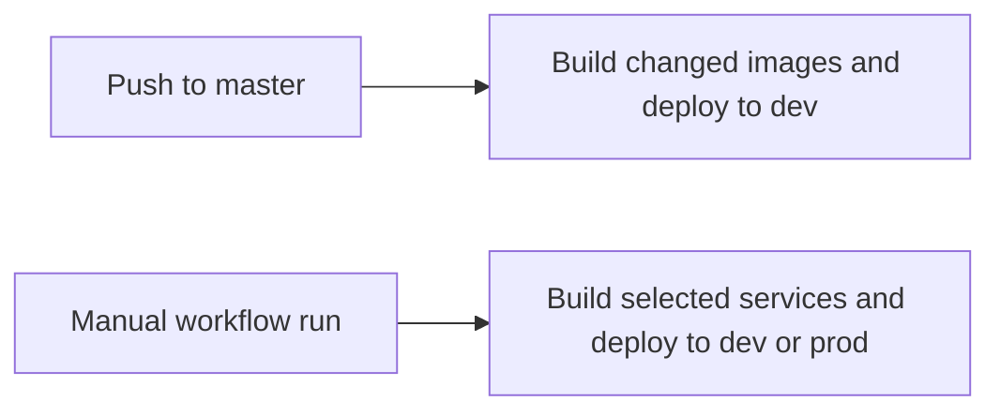

# Application deployment

**Created**: 2026-11-04
**Last updated**: 2026-11-05

This guide explains the deployment implemented by
[the workflow](../.github/workflows/deploy-application.yml),
[deployment scripts](../scripts/deploy/), and [Terraform](../infra/).
It describes source configuration, not verified live infrastructure.
Required behavior remains in the [deployment spec](../specs/platform/deployment.md).
Significant choices remain in [decision records](../specs/decisions/README.md).

Read the section needed for the task. For operator setup, use the
[runbook index](runbooks/README.md).

## Routing and TLS

The cloud stack uses `compose.production.yml` in both `dev` and `prod`.
Only the edge Nginx service publishes a host port, 443. Application `/api`
requests go directly to the backend with their prefix preserved. Other application
requests go to the frontend, whose own Nginx serves static assets and SPA fallback.
Landing hostnames go to the landing container.

Keep public DNS records proxied through Cloudflare. Use Full mode for the
self-signed Nginx origin certificate and enable the edge HTTP-to-HTTPS redirect.
DNS-only records expose the self-signed certificate to browsers. Flexible calls
the closed origin port 80. Full (strict) rejects that certificate.

Nginx generates its origin certificate on first start. The edge configuration
reads `LANDING_HOSTNAMES` and `APPLICATION_HOSTNAMES` as space-separated lists.
The workflow reads these and the single HTTPS URLs `LANDING_BASE_URL` and
`APPLICATION_BASE_URL` from GitHub variables in its top-level `env` block.
Cloudflare routing is configured separately. The verification job requests the
public names after deployment.

## Terraform workspaces

Workload Terraform in `infra/` accepts only `dev` and `prod`. Region is
`us-east-2`. Resource names use `kb-<env>-<component>`.
The project name `karlbruder` and slug `kb` are fixed locals.
Use the `env` tag for the workspace, without a second `environment` tag that
could be confused with development/production mode.

| Tag | Value |
| --- | --- |
| `author` | `Terraform` |
| `scope` | `regional` |
| `env` | `dev` or `prod` |
| `project-name` | `karlbruder` |
| `project-slug` | `kb` |
| `repo` | `karlbruder/karlbruder_monorepo` |

Remote state uses bucket `kb-terraform-976083331699-us-east-2-an` in `us-east-2`
and key `monorepo.tfstate`. Workspace state is `dev/monorepo.tfstate` or
`prod/monorepo.tfstate`. Both share the bucket because the backend block cannot
select one per workspace. Locking uses the S3 lock file.

## Application host

| Setting | Current configuration |
| --- | --- |
| Placement | One EC2 instance per workspace, default VPC, first sorted default subnet, Elastic IP |
| Image | Latest Canonical Ubuntu 24.04 LTS x86_64 AMI |
| Size | `t3a.micro` in dev, `t3a.small` in prod |
| Name | `kb-<env>-application-host` |
| Root volume | Encrypted gp3, 30 GiB, 3000 IOPS, 125 MiB/s. Retained after termination |
| Ingress | TCP 443 from the Cloudflare IPv4 list in `infra/main.ec2.application-host.tf` |
| Operator access | Session Manager. No SSH key, port 22, or origin port 80 |
| Instance policies | `AmazonSSMManagedInstanceCore`, `CloudWatchAgentServerPolicy` |
| Metadata | IMDSv2 required, response hop limit 2 |

Containers that reach metadata share the instance role's authority, including
backend secret access. [Decision 0005](../specs/decisions/0005-container-access-to-instance-role.md)
records acceptance and safeguards.

Egress permits DNS on UDP/TCP 53, Ubuntu package mirrors on TCP 80, HTTPS on TCP
443, Supabase PostgreSQL on TCP 5432/6543, SES SMTP on TCP 587, and NTP on UDP 123.
Refresh the configured Cloudflare IPv4 list when its published ranges change.

Terraform manages a CloudWatch log group for each service in each workspace,
named `/<namespace>/<service>`. The groups retain logs indefinitely and Terraform
prevents their destruction. Apply Terraform before deploying the Compose logging
configuration. Docker sends each container’s standard output and standard error to
its service group. Docker uses the container ID as the default stream name.
Recreate containers to apply logging changes.

First boot installs the CloudWatch agent, Docker Engine, and Compose, and creates
`/opt/karlbruder`. CloudWatch alarms cover high/critical CPU, memory, root-disk usage,
and failed instance status. Agent metrics and alarms use 60-second intervals.
The CPU alarms use agent metrics rather than the five-minute basic EC2 metric.
Alarms have no SNS notifications. AWS Backup is not configured.

AMI or bootstrap edits do not replace a running instance automatically.
Replacement is deliberate. Retained volumes and versioned objects do not establish
verified backups or recovery.

## External services

Follow the [S3 runbook](runbooks/application-files-s3-bucket.md) for the private
upload bucket, object permissions, browser CORS, and backend secret setting.
Object versioning is enabled. The host has object `PutObject`, `GetObject`, and
`DeleteObject` permissions, without a blanket `ListBucket` grant.

Follow the [SES runbook](runbooks/supabase-auth-email-ses.md) for the account-level
Supabase Auth mail identity, DNS verification, and custom SMTP. This is distinct
from future backend tournament/payment notifications. Auth mail uses Portuguese
templates under AUTH-011.

## Workflow and image selection

A push to `master` deploys `dev`. Manual dispatch selects `dev` or `prod` and one
service or all services. `dorny/paths-filter` v4 selects changed services on push.
Changes to `compose.production.yml`, the deploy workflow, or `scripts/deploy/`
build all four services. The workflow uses major-version action tags.

Each workspace has four ECR repositories under `kb-<env>/`: `landing`, `frontend`,
`backend`, and `nginx`. The host role can pull only its environment's repositories.
Images built in a run receive the release git SHA and the moving `dev` or `prod`
tag. The host runs the SHA, not the moving tag.

For an unchanged service, `tag_unchanged_images.py` retains an existing release-SHA
tag or copies the environment tag onto that SHA. Every service must have an image
from an earlier build before it can be reused. Reused images retain their original
build metadata.

The pipeline generates one UTC `RELEASED_AT` per run. Backend, frontend, and landing
production images embed it and `GIT_SHA`. Restarting a container does not change
that metadata.



## Build inputs

The landing image receives `APPLICATION_BASE_URL` as `REACT_APP_APPLICATION_URL`.
Use one HTTPS origin without a path, such as `https://app-dev.karlbruder.com` or
`https://app.karlbruder.com`. Local development uses `http://localhost:5173`.
The page falls back to `https://app.karlbruder.com` for an empty value. Changing a
GitHub variable requires rebuilding and deploying the image to change the link.

Frontend builds use the selected GitHub environment's `VITE_SUPABASE_URL` variable
and `VITE_SUPABASE_PUBLISHABLE_KEY` secret. The URL is a build argument. The key is
a BuildKit secret and is still public in the resulting browser bundle. The builder
stage is rebuilt so key rotation cannot reuse an old bundle. Vite validates the
required names without printing values and rejects legacy JWT or server-only keys.
`VITE_API_BASE_URL` defaults to `/api`.

See the [frontend configuration guide](../frontend/README.md#configuration) for
key migration and redirect setup. Disable the hosted Data API in both cloud
environments and review existing/default grants on domain tables for `anon` and
`authenticated`. Deliberately exposed data requires explicit grants and appropriate
Row Level Security. The workflow does not apply or verify those hosted settings.
Disabling the Data API does not disable the publishable key used for Auth.

## Backend configuration and migrations

Terraform creates the `kb-<env>/backend` Secrets Manager secret shell and grants
the host role `secretsmanager:GetSecretValue`. An operator must supply the backend
settings JSON after apply. The secret uses the AWS managed key, so the host does
not need a separate decrypt permission.

Each deploy writes `/opt/karlbruder/backend.env` with `ENV_NAME`, `SECRET_NAME`, and
`AWS_REGION`. The selected secret supplies database and Supabase settings. Add
`SUPABASE_SERVICE_ROLE_KEY` to each backend secret before deploying role
management. Use the legacy `service_role` key for that environment’s Supabase
project. The backend requires this key at startup. Keep it out of frontend build
settings.

The production image includes the Secrets Manager dependencies. Its entrypoint
runs `alembic upgrade head` once per container startup, before Gunicorn workers.
Failure prevents API startup. On success, the entrypoint replaces itself with
Gunicorn so shutdown signals reach the server. Development and test startup do
not use that entrypoint. See [database migrations](database-migrations.md) for
application, reset prerequisites, and verification. Never reset production data
to make startup pass.

## Host update

Build, stamp, and deploy use one OIDC role. Follow
[GitHub Actions access](runbooks/github-actions-access.md) for setup and policies.
`deploy_application.py` finds the intended host and sends its update through
Session Manager. The payload includes `update_application_host.py`, the shared
`common.py` command helpers, and Compose content. Scripts take deployment inputs
as required command-line options. Routing hostnames come from the workflow,
not an environment-to-hostname mapping inside the scripts.

The scripts use the Python standard library. The Ubuntu 24.04 GitHub runner has
Python 3 and the AWS CLI. `aws-actions/configure-aws-credentials` supplies credentials.
The application host needs Python 3, the AWS CLI, and Docker with Compose.
Session Manager launches the host script through its shell document.

The host script supplies Compose interpolation values through its process
environment, logs in to ECR, pulls all four release-SHA images, and updates the
stack with `up --wait`. It then recreates edge Nginx to refresh container addresses,
verifies each container's image tag, and prunes dangling images. There is no zip
or SCP deployment path. A landing-only build still uses this combined release path.

## Release verification

After the host reports success, `verify_application_release.py` requests the
landing URL, application URL, `/api/health`, and `/api/metadata`. The expected
health response is 200. The current script accepts successful HTTP responses
without a separate exact-status assertion. When the run built the backend,
metadata must match the release SHA and the
run's build timestamp. A reused backend retains its original image metadata.

The selected GitHub environment supplies `CLOUDFLARE_HEALTH_CHECK_SECRET`.
Verification requires a nonempty value and sends it in `x-health-check` on every
public request, including retries, for the configured Cloudflare CI bypass.
Keep the value out of command-line arguments and logs. DNS and Cloudflare must
already be configured for these public checks to succeed.

From the repository root, deployment-script tests use mocked external calls:

```sh
python3 -m unittest discover -s scripts/tests -v
```

Source inspection and mocked tests do not verify live DNS, IAM grants, migration
state, or end-to-end release health. Failed-release recovery, backups/restoration,
and landing account/DNS cutover still need verified procedures. Follow PRIV-011's
interim indefinite retention. Do not treat object versioning as tested recovery.

## Earlier deployment issues and reconciliation

The earlier issues describe deployment transport evolution. Their backend-only topology and older Compose filename are historical inputs superseded by decision 0003. These issue bodies have not been changed, and their deployed state has not been verified.

| Source | Earlier delivery plan | Reconciliation needed |
| --- | --- | --- |
| #25 | Initial EC2 host with zip/SCP, interactive access, and build/start on host | Deploy the Nginx, landing, frontend, and backend stack in `compose.production.yml` rather than a backend-only service |
| #13, depends on #25 | Session Manager replaces day-to-day inbound SSH; zip/build-on-host remains | Verify managed file transfer and remote execution for the combined stack |
| #23, depends on #13 | Build/push backend image to ECR; host pulls and restarts through Session Manager | The deploy workflow builds the changed images among landing, frontend, backend, and Nginx, then replaces those containers through Session Manager. A live run is still unverified |
| Private frontend hosting draft | S3 hosting versus hosting beside the backend | Resolved in favor of the frontend container behind the application Nginx proxy |

Issue #23's image deploy is the workflow described above. It replaces the zip and build-on-host path. Migration and failed-release recovery are still open. The workflow now requests the public names after deploy, and that request still needs DNS and Cloudflare to be in place. Earlier HTTP-only host setup is not the finished HTTPS application deployment. Host egress includes SES SMTP on TCP 587 and Ubuntu package mirrors on TCP 80.
