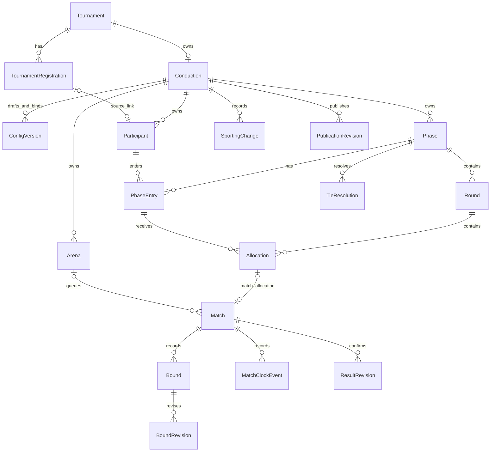
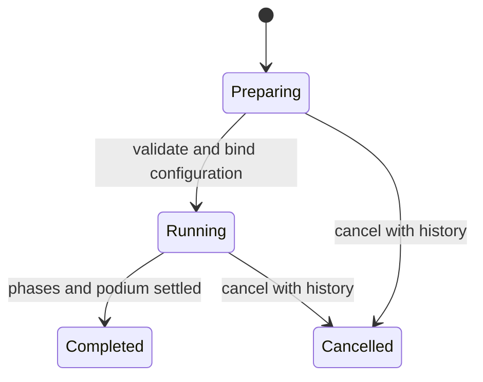
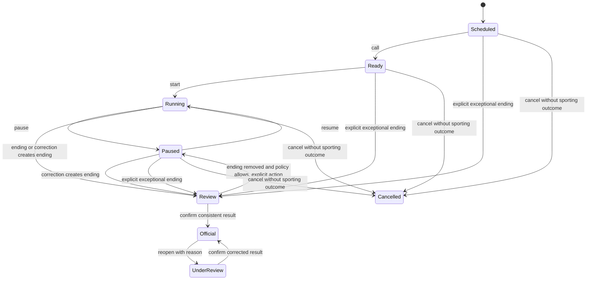

# Tournament conduction persistence and operations

**Created**: 2026-11-27
**Last updated**: 2026-11-27

This proposal extends the [policy model](tournament-conduction-model.md). It describes a future backend, not existing tables or endpoints. The governing rules remain [TC-001–026](../specs/tournaments/conduction.md#rules), [MONO-006–022](../specs/tournaments/events/monomachia-2027.md#conduction-rules), and [RES-001–012](../specs/tournaments/results.md#confirmed-direction). The identifiers and routes below illustrate a consistent implementation contract. The current catalog, registration and identity systems remain authoritative for their own data.

## Persistence ownership and relationships

All proposed domain rows belong in PostgreSQL `public`, alongside the existing `Tournament` and `TournamentRegistration`. Supabase Auth retains user identity. Actor references are verified Supabase subjects, not new local accounts. These are logical entities, not a prescribed migration or a claim that all fields below are sufficient indexes. Integer IDs and timestamps follow the backend conventions. Backend services enforce cross-row workflows using transactions and ordinary constraints. [Decision 0010](../specs/decisions/0010-database-functions-trigger-and-procedures.md) forbids application-defined functions, triggers and procedures.



`Allocation` has exactly one phase entry per row and a kind of match or bye. Two match allocations point to the same match. A bye allocation points to no match. This diagram omits scoped foreign-key columns and references from revisions to their inputs for readability. The table defines them.

| Entity | Key fields, ownership and integrity | Rule / purpose |
| --- | --- | --- |
| Conduction | One row per existing tournament, unique `tournament_id`. State `preparing`, `running`, `completed` or `cancelled`, a revision counter, draft version ID, bound version ID and Arena allocation cursor. Composite references ensure versions belong to this conduction. | TC-001, TC-025/026. Separate from catalog dates and registration lifecycle. |
| ConfigVersion | Conduction ID, monotonically assigned version, complete validated strategy IDs and parameters, creation actor/time and lifecycle `draft` or `bound`. Unique `(conduction_id, version)`. An edit creates a new version and moves the draft pointer. A start binds the current version. Backend services reject later edits to that conduction's binding. | TC-024/025. Match and result resolve through the bound ID. Historical versions remain identifiable without DB immutability triggers. |
| Participant | Conduction ID, optional source registration ID, source origin, explicit local display-name override, attendance and participation state. Unique `(conduction_id, source_registration_id)` when linked. A scoped foreign key ensures the registration belongs to the same tournament. Never identify or merge by name. | TC-004–007. Source refresh reports created, updated, unchanged and conflicting records. Omission never deletes history. |
| Phase / PhaseEntry | Phase has conduction ID, configured phase key, order and operational state. Entry has phase ID, participant ID, eligibility/inclusion and state. Unique participant per phase. Scoped references require participant and phase in the same conduction. | TC-011/012. Final entries reuse participants with phase-local standings. |
| Arena | Conduction ID, positive number, optional name and configured sequence. Numbers and sequence positions are unique within a conduction. | TC-008–010. Numbered Arena is separate from sporting pairing. |
| Round / Allocation | Round belongs to phase and has a kind `regular` or `tie_break`, phase-local order within that kind, state and publication revision. Tie-break rounds are additional and do not consume the configured regular round count. Allocation belongs to round and phase entry, with `match` or `bye`, status and optional match ID. Unique `(round_id, phase_entry_id)` prevents a participant receiving both a match and bye in one round. | TC-012/013. Service validates two distinct entries in the same phase per match and confirms each bye once. |
| Match | Round ID, two same-phase entry IDs, kind `regular` or `tie_break`, optional Arena and queue position, state, revision, bound configuration ID and clock state. Scoped references keep round, entries, Arena and configuration in one conduction. Service ensures its two allocations agree with both entries. Queue positions are unique per Arena. | TC-009–018. Started or published matches are never silently replaced by correction. |
| Bound / BoundRevision | Bound has match ID and a unique, never reused occurrence order. Revisions identify draft, accepted or voided content, scoring side, outcome and zero to two warning recipients. Each accepted revision supersedes a prior revision with actor, time and reason where required. A draft is staff-only and has no sporting effect. | TC-015/016/019. Void removes that occurrence's warnings. An inconclusive accepted outcome can retain warnings. |
| MatchClockEvent | Match, per-match sequence, transition, server timestamp and accumulated running duration. Current match clock stores the latest accepted state, elapsed duration and running anchor. | TC-014/017. Retains pause/resume and ending history. |
| Sanction and adjustment | Derived sporting warning promotions, cards and phase ranking adjustments identify their source bound revision, participant, match, phase and calculation generation. Store their provenance with result snapshots. Rebuild projections after corrections without deleting old result evidence. | MONO-010–012/019/020. Use sporting occurrence chronology. A deduction is not a scoring attack. |
| TieResolution | Phase, tied entry set, reason, state, referenced duel matches, chosen resolution and supporting revisions. An unresolved case stays pending. Age evidence remains private and does not enter the spectator projection. | MONO-018/019/022. A changed sanction can mark a tie for review. |
| SportingChange and dependency review | Actor, server time, reason, target and before/after revision IDs. A review item identifies the exact affected published round, tie, qualifier, final entry or podium decision and its state. Record explicit reconciliation and its actor. | TC-019/020. Earlier decisions stay identifiable. Review is not automatic replacement. |
| ResultRevision / PublicationRevision | A result revision snapshots match inputs, bound configuration, outcome, applicable sanctions and calculation version, with explicit confirmation actor/time. A publication revision snapshots the settled phase standings, qualifying decisions, podium and source result revisions. Both have an ordinal and supersession/review state. | TC-018–020, RES-009/010. Official confirmation and final publication are separate. Earlier versions remain identifiable. |
| MutationReceipt | Unique `(actor_subject, operation_scope, idempotency_key)`, canonical request hash, outcome and response reference, written in the same transaction as the mutation. | TC-022. A retry returns the original accepted response. A reused key with a different payload is rejected. |

Relational constraints enforce non-null fields, allowed states, positive numbers, scoped foreign keys and uniqueness. Use the same scoped keys on dependent rows so a cross-tournament Arena, participant or configuration cannot be attached. Backend services check the exact pair of allocations, phase membership, eligibility, valid transitions and dependencies under locks. Do not encode workflow or audit immutability using triggers or restrictive constraints. Authorized direct database corrections bypass service guarantees and require operator reconciliation under decision 0010.

## States and accepted records





The explicit transition from `Review` to `Paused` never resumes combat by itself. A no-ending correction preserves the existing running or paused clock. A result revision becomes official only after drafts are settled, the ending is valid and staff confirm. An accepted bound affects the provisional view immediately. A saved draft, rejected request or failed transaction never does. An official result alone contributes to official standings. Final publication is a separate action.

Phases move from draft to ready, running and completed. Rounds move from draft to published and completed. Staff review pairings and byes before publishing. All matches must be official and byes confirmed to complete a round. Later rounds and qualifiers require their configured predecessors and resolved relevant ties. A correction marks each affected dependency under review. It does not rewind or rewrite already published or started decisions. Confirmation and publication of affected dependents remain blocked until explicit reconciliation.

## Concurrency, time and projections

Use PostgreSQL transactions in backend services with row locks and optimistic revision checks. A top-level workflow commits or rolls back the entire operation. Lock the conduction row first for every sporting mutation or expiry settlement, then affected phases, rounds and matches in stable ID order. Compare each supplied revision after acquiring the locks. Return a conflict rather than overwriting accepted changes. This serializes the relatively small number of staff operations per tournament and avoids process-local coordination across API workers. It does not introduce Redis or database triggers.

For every mutating request, require an `Idempotency-Key` scoped to actor and operation. Hash the method, scoped resource, body and `If-Match`, and store the hash and response in the same transaction as the change. Check the receipt before checking the current revision, so a retry of a committed request succeeds even if its original revision is now stale. A concurrent duplicate waits on the unique receipt and returns the committed result. If the first transaction rolls back, a retry can execute. Same key with a different request returns `409 idempotency_key_reused`. A new key with stale `If-Match` returns `409 stale_revision` with current revision and a refresh instruction. No failed attempt produces an accepted receipt or partial sporting change.

PostgreSQL server time is the shared authority. Under the locks, use a fresh database clock reading such as `clock_timestamp()`, not a client timestamp or a transaction-start timestamp, to accumulate elapsed running time and write start, pause, resume and stop events. This built-in clock is not an application-defined database function. Bound recording leaves the clock running. After authorizing the request, the first backend access that observes a time-limited match past its deadline atomically materializes the deadline transition at the calculated expiry instant, before serving the result or accepting another mutation. A read may therefore perform this idempotent housekeeping transaction. Competing requests lock the same match and observe one transition. An untimed duel has no deadline. Clients poll even while idle, but expiry does not depend on one browser being open. If all clients disconnect, the next access settles the deadline from the persisted anchor rather than granting extra time. Database and application hosts must keep clocks synchronized. Operators must investigate material backward clock corrections rather than silently award extra fight time.

For live consultation, use authorized HTTP polling of backend projections, initially every two seconds while visible and immediately on focus or recovery. The response carries `revision`, `server_now`, accepted clock state, remaining duration at `server_now` and an `as_of` timestamp. The client may interpolate a running clock locally for display and clamps it to zero. The backend remains authoritative for acceptance and endings. Conditional reads can avoid retransmitting unchanged sporting content, but a clock response must still carry current server time. Polling avoids introducing a persistent connection or broker in the existing stack. On timeout, retain the last known values with an explicit unavailable or stale label. Do not claim that a pending write succeeded. A reload fetches the current projection and resumes interpolation from the returned server anchor.

Build projections from committed accepted records and their bound policy. Staff can see drafts, reasons, conflicts and controls through staff endpoints. The shared sporting projection includes released schedules, Arena, athletes' display names, accepted bound outcomes, score, clock, sporting sanctions, status, official standings and permitted placement. It excludes contact details, registration IDs, full birth dates, proofs, safety notes, private incident reasons and staff history. Public guests may read released non-internal events. Internal events require member or admin authorization on every read, including polling. A participant role alone does not override that restriction. Each read is scoped to one tournament, and restricted or unavailable responses must not leak the prior event's state. RES-003/004/008/011/012 apply.

## Application and API contract

All mutation examples are proposed HTTP operations under `/api/tournaments/{tournament_id}/conduction`. They require existing global admin authorization, `Idempotency-Key` and an `If-Match` revision of the named aggregate. Responses use `200` for accepted transitions, `201` for creation, `400` for malformed input, `403` for forbidden access, `404` for an unavailable scoped object, `409` for state, revision or dependency conflicts and `422` for invalid policy or sporting values. A successful response contains the new revision and accepted state. A failed mutation rolls back all of its changes. The final route names are implementation choices. The observable contracts are not optional.

| Operation | Input, atomic effect and representative conflicts |
| --- | --- |
| `PUT /configuration` | Admin submits a complete configuration and expected conduction revision. Validate the policy matrix and references, create a new draft version and advance the draft pointer. `422 invalid_configuration` lists field errors. `409 configuration_locked` follows start. |
| `POST /start` | Lock the conduction row, check its revision, validate the current complete draft and atomically bind it while changing `preparing` to `running`. A racing edit or start sees a stale revision. An invalid draft leaves both state and binding unchanged. |
| `POST /participants/refresh` | Select currently eligible registrations in the same tournament and upsert by source registration identity within one transaction. Report each source as created, updated, unchanged or conflicting. Preserve explicit local name overrides, omitted participants and all history. Newly seen entries after a phase start remain pending inclusion. A conflicting source link is reported without merging. |
| `POST /participants/{id}/link` and `PATCH /participants/{id}/attendance` | Explicitly link a same-tournament eligible source to a participant, retaining the participant ID and results. A source already linked elsewhere yields a conflict. Attendance only changes presence. It does not change registration, eligibility, pairings or WO. Minor participation checks stay private. |
| `POST /arenas` and `POST /rounds/{id}/allocate` | Save a numbered Arena or allocate reviewed ordered matches cyclically. The transaction locks the allocation cursor and appends stable per-Arena queue positions. Zero Arenas gives `409 arena_required`. Allocating eight matches to three Arenas in one batch or two yields 1,2,3,1,2,3,1,2 with queues of 3,3,2. |
| `POST /rounds/{id}/publish` and `POST /matches/{id}/call` | Validate same-phase distinct entries, exclusive bye/match allocations, required predecessor and reviewed pairings before publishing. Calling selects the next queued match explicitly. Missing check-in or call response does not create WO. Started opponents cannot be replaced by ordinary editing. |
| `POST /matches/{id}/clock/{start,pause,resume}` | Lock match and settle expired time first. Verify transition and expected revision. Record server clock event and new accumulated duration in one transaction. A transition after expiry conflicts with `match_in_review`. |
| `POST /matches/{id}/bounds` | Create a draft occurrence with unique order. `POST /bounds/{id}/confirm` validates the selected outcome, side and warning recipients against the bound policy, then accepts the revision and recalculates provisional effects. A newly reached regular or exceptional ending stops the clock and moves to review in the same transaction. Reject an eighth valid Monomachia bound. |
| `POST /matches/{id}/result/confirm` | Settle expired time, reject unresolved drafts or an absent ending, snapshot the confirmed result and apply official standing effects once. Repeating an accepted key returns the same result. A new duplicate confirmation cannot award credit again. |
| `POST /rounds/{id}/complete`, `/phases/{id}/qualifiers`, `/tie-resolutions/{id}/confirm`, `/publish` | Confirm byes and complete only when all matches are official. Confirm eligible qualifiers and tie decisions only when prerequisites are settled. Create later configured rounds/final or extra duels as operational actions under the frozen version. Publish a retained, identified final revision only when affected review items are reconciled. |
| `POST /phases/{id}/rounds` and `POST /reviews/{id}/reconcile` | Generate the next permitted regular round or a separate tie-break round from the bound policy and accepted prerequisites. Reconciliation identifies the reviewed dependency, decision and reason. It records staff confirmation or an explicitly authorized replacement decision without silently changing a published or started match. A stale input or unresolved upstream review blocks the action. |
| `POST /matches/{id}/reopen`, `POST /bounds/{id}/correct` or `/void` | Require a reason, preserve earlier accepted records and result snapshots, recompute effects and atomically flag each affected dependency for explicit review. If an ending is created from running or paused, stop at the accepted server time and enter review. If no ending is created, preserve the clock state. Reconfirmation creates a new official revision. Explicit reconciliation and republication are separate actions. |
| `GET /view` and `GET /matches/{id}/view` | Apply event audience rules and return the released shared sporting projection, clock and freshness fields. Staff-specific views include editable drafts and private review details only after admin authorization. A guest's internal-event request is restricted. |

### Representative exchanges

These examples omit unrelated fields. IDs are illustrative and scoped to one tournament. `If-Match` contains the numeric revision returned by the previous read.

```http
PUT /api/tournaments/12/conduction/configuration
If-Match: "3"
Idempotency-Key: 8e6a
Content-Type: application/json

{"policy": {"regular_end": {"strategy": "time_or_valid_bounds", "seconds": 180, "valid_bounds": 7}, "...": "other required policy fields"}}
```

The ellipsis stands for the complete validated matrix, not a literal accepted field. A valid full submission returns `200` with `{"revision":4,"draft_version":2}`. `POST /start` with `If-Match: "4"` binds version 2 and returns `{"revision":5,"state":"running","bound_version":2}`. A later `PUT` returns `409 configuration_locked`, including for future matches. A separate tournament can still edit its own draft.

```http
POST /api/tournaments/12/conduction/matches/41/bounds/9/confirm
If-Match: "8"
Idempotency-Key: 4c32
```

An accepted request returns `200` with `{"match_revision":9,"bound_id":9,"status":"confirmed","result_state":"running"}`. Retrying the same key and request returns that response without another bound or promotion. A different key against revision 8 receives `409` and `{"code":"stale_revision","current_revision":9}`. Reusing `4c32` with different content returns `409 idempotency_key_reused`. No pending or rejected response is projected as accepted.

An authorized match view can return `{"revision":9,"status":"running","score":{"a":3,"b":0},"clock":{"state":"running","remaining_ms":145000,"server_now":"2026-11-27T15:00:00Z"},"bounds":[{"order":1,"outcome":"alvo","side":"a"}]}`. It contains no registration identifier or private birth date. If polling fails, the client marks this value unavailable or stale. When the session returns, it fetches the new server state instead of restarting 145 seconds.

For a corrected official match, a reasoned reopen retains result revision 1 and marks affected published decisions under review. After accepting a correction and confirming the new result, revision 2 is official while those decisions still require staff reconciliation. The prior final publication remains identifiable as under review. A separate successful publication creates revision 2 of the final publication. A failed or stale correction creates neither a new accepted bound nor a result revision.

## Traceability and verification scenarios

| Contract | Check in a future implementation |
| --- | --- |
| TC-AC-001/002/017/019, TC-AC-021 | Two tournaments with overlapping names and independently editable drafts remain isolated. Two admins can operate either. Repeated refresh and explicit links preserve history. Start/edit races bind only one validated version and later edits fail. |
| TC-AC-003–008/018 | Attendance does not alter registration or pairings. Numbered Arenas allocate cyclically across batches. Zero Arenas blocks allocation. Invalid cross-phase, duplicate or self allocations fail. A minor's private requirements remain separate. |
| TC-AC-009–013/022 | Reload restores the server clock. Drafts and failures are not accepted projections. Concurrent stale edits conflict. Repeated requests do not duplicate bounds, sanctions, imports or ranking effects. Correction-created ending from running or paused stops for review. |
| TC-AC-014–016/020 and MONO-020–022 | Reopen and correct with reason. Preserve prior official revisions, recalculate effects and mark later published decisions for review. Reconciliation and republication are explicit. Unresolved exceptional outcomes block dependent decisions. |
| RES-AC-001–012 | Exercise guest/member/admin reads for internal and non-internal events. Confirm accepted provisional updates, official standings and separate final publication. Test stale/unavailable states and ensure private fields and staff controls never appear in shared projections. |

Exact ranking, Swiss pairing, chronology and worked correction calculations are specified in the next checkpoint. This document fixes their inputs, version binding, transaction and revision boundaries without claiming those calculations are already implemented.
