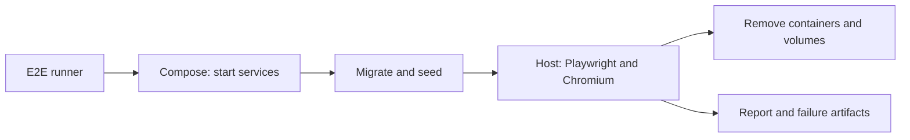
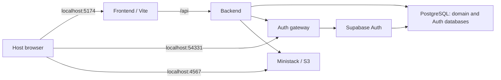
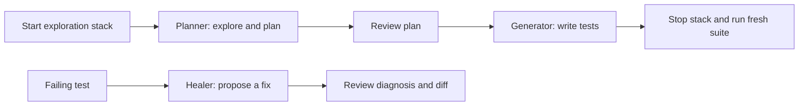

# End-to-end tests

**Created**: 2026-11-20
**Last updated**: 2026-11-28

Browser journeys exercise the application across real service boundaries with
synthetic data. For rules about changing E2E tests and fixtures, also read
[AGENTS.md](AGENTS.md).

## Start here

Run commands from the repository or worktree root. You need Docker and Compose,
Node.js, OpenSSL, curl, and `make`.

```sh
npm ci --prefix e2e
npx --prefix e2e playwright install chromium
make test-e2e
```

| Goal | Command |
| --- | --- |
| Run the full suite | `make test-e2e` |
| Run one journey | `./scripts/e2e/run.sh tests/payment-approval.spec.ts` |
| Run the waitlist journeys | `./scripts/e2e/run.sh tests/waitlist.spec.ts` |
| Start an agent exploration stack | `E2E_MODE=explore make test-e2e` |

## Watch and debug tests

To watch the tests run in a browser on the host:

```sh
./scripts/e2e/run.sh --headed --workers=1
```

To pause and step through a journey with Playwright Inspector:

```sh
E2E_MODE=debug ./scripts/e2e/run.sh tests/payment-approval.spec.ts
```

Omit the test path to debug the whole suite. Both commands run checked-in tests
against a fresh disposable stack. They do not invoke an agent. See
[Playwright agents](#playwright-agents) for agent-assisted work.

## How a run works



The runner uses a fresh disposable stack and cleans it up after success or
failure. It generates temporary Auth keys, a certificate, and fixture metadata.
Normal tests exclude `tests/seed.spec.ts`, which is the agent exploration entry
point. The [seed package](../scripts/e2e/seeds/) creates synthetic accounts and
other data for isolated user journeys across the application. Its
[accounts](../scripts/e2e/seeds/accounts.py) are only for this stack.



Compose runs the frontend, backend, PostgreSQL, Supabase Auth, and Ministack.
The backend validates real Auth tokens using the local service's JWKS. The
published ports bind to loopback only. PostgreSQL and the backend are not
published. The normal development ports do not change. This stack uses an empty
container-only backend `.env` and does not need development env files or a hosted
Supabase project. SMTP and Sentry are disabled. Auth automatically confirms
accounts and uses a no-op mailer.

Each run uses a unique Compose project beginning with `kb-e2e-`. You can set
`E2E_PROJECT` to another unique name with that prefix. The runner refuses to
reuse existing project resources. Fixed host ports prevent concurrent E2E runs.

## Reports and troubleshooting

| Artifact | Location |
| --- | --- |
| HTML report | `e2e/playwright-report/` |
| Failure traces | `e2e/test-results/` |
| Service logs after failure | `e2e/artifacts/services.log` |

These artifacts are ignored by Git. Open the report with:

```sh
./e2e/node_modules/.bin/playwright show-report e2e/playwright-report
```

## Playwright agents

Normal test runs do not invoke an agent or need model API credentials. The agent
workflow uses a separate live exploration stack:



Use a fresh exploration stack for each journey. The healer cannot reliably
separate a stale test from a product regression. Review its evidence and preserve
meaningful assertions. Fix the application if it violates expected behavior.
Keep credentials and browser session files out of plans and artifacts.

For agent work, prefer Cursor with an available Grok model and integration.
Otherwise use Codex. Choose a suitable model and reasoning effort, keep tasks
focused, and check the model and usage in Cursor. Availability and pricing
depend on the account.

### Cursor

1. Install the dependencies above and open the repository root as a Cursor project.
2. Enable `playwright-test` and `playwright-healer` from [`.cursor/mcp.json`](../.cursor/mcp.json)
   and verify that both connect. Planner and generator use the seed-only config.
   Healer uses the regular test config.
3. Select an available Grok model. Inspect the subagent task card to confirm the
   model used. If Grok or the MCP connection is unavailable, use Codex.
4. In a separate terminal, run `E2E_MODE=explore make test-e2e`. Wait for the
   frontend URL and temporary fixture metadata path. Leave the terminal open.
5. Ask Cursor to use `/playwright-planner`, review the plan, then use
   `/playwright-generator`. For a failure, use `/playwright-healer` and review
   its diagnosis. Press Enter in the exploration terminal to clean up, then run
   `make test-e2e` with fresh data.

The [Cursor agent definitions](../.cursor/agents/) adapt Playwright's agent
workflows. Playwright has no Cursor-specific `init-agents` option. Review these
definitions and MCP connections after updating Playwright. See
[Playwright Test Agents](https://playwright.dev/docs/test-agents),
[Cursor MCP](https://cursor.com/docs/mcp), and
[Cursor subagents](https://cursor.com/docs/subagents).

### Codex

The [project config](../.codex/config.toml) connects `playwright-test` and
`playwright-healer` to the parent Codex session. The former uses
`playwright.agents.config.ts` and discovers only the seed. The latter uses the
regular configuration and discovers journeys without the seed. Both use the
locked Playwright package. The [agent definitions](../.codex/agents/) were
adapted from `playwright init-agents --loop=codex`.

1. Install the dependencies above. Open the repository or worktree as the Codex
   project and trust its configuration. Restart the app and reopen the chat if
   needed after changing MCP configuration.
2. Verify both MCP connections in the active session. In the CLI, `codex mcp list`
   shows enabled servers and `/mcp` shows active connections. In the desktop app,
   ask Codex to check both connections. A listed server does not prove the chat
   connected to it.
3. In a separate terminal, run `E2E_MODE=explore make test-e2e`. Wait for the
   frontend URL and temporary fixture metadata path. The metadata identifies
   seeded tournaments, the payment registration, and the staff account UUID.
   Leave the terminal open during exploration. An ignored temporary fixture link
   is removed during cleanup.
4. Ask Codex to use the Playwright planner with the agent seed and journey.
   Review the plan, then ask it to use the generator. Use `playwright-healer`
   for a focused proposed fix. Press Enter to stop the exploration stack, then
   run `make test-e2e` with fresh data.

An MCP entry in an agent definition alone does not connect the parent session.
No global `codex mcp add` is needed. If a server cannot start, check project
trust, the host `node` PATH, `npm ci`, the worktree root, and active connections.
Regenerate and review the definitions after Playwright updates. Regeneration can
overwrite project adaptations. See
[Playwright Test Agents](https://playwright.dev/docs/test-agents) and
[Codex MCP configuration](https://developers.openai.com/codex/mcp).
