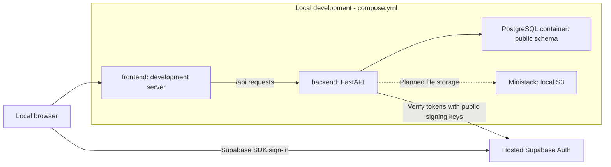
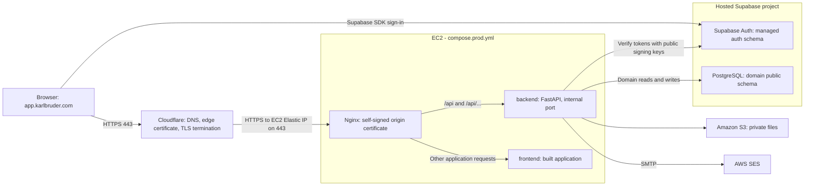

# Architecture

| Field | Value |
| --- | --- |
| Status | Draft |
| Scope | Application boundaries and explicit local/production stacks |
| Sources | Product-owner overview, registration answers, and stack clarification; [project source map](README.md#project-source-map); source inspection on 17 October 2026 |

## Application boundaries

`landing/` presents Karlbrüder at `karlbruder.com.br` and links to social channels, event information, and the application. `frontend/` and `backend/` form the application at `app.karlbruder.com`. The application's production Compose stack does not host the separate public landing site.

The following stacks describe intended architecture, not verified deployments. [Decision 0003](decisions/0003-local-and-production-stacks.md) records the owner's choices.

## Environment comparison

| Responsibility | Local development | Production |
| --- | --- | --- |
| Application stack | `compose.yml`: frontend, backend, PostgreSQL; Ministack added when file storage is implemented | `compose.prod.yml`: Nginx, frontend, backend |
| Application entry | Existing development ports and frontend `/api` forwarding | Cloudflare HTTPS edge to EC2 Elastic IP, then Nginx on 443 |
| Identity | Hosted Supabase Auth | Hosted Supabase Auth |
| Domain database | PostgreSQL container, domain objects in `public` | Hosted Supabase PostgreSQL, domain objects in `public`; no PostgreSQL container |
| Private file storage | Ministack's local S3 emulation, planned | Amazon S3 |
| Application email | Decision deferred; likely real SES with real AWS/SES credentials | AWS SES via SMTP |

## Local development stack

Local development still uses hosted Supabase for authentication, while domain PostgreSQL runs locally in Docker. The backend writes domain data to the local `public` schema and uses the same verified Supabase user UUIDs as its ownership references. A local domain database does not require a local copy of Supabase's `auth` schema.

Ministack is the chosen local AWS emulator for S3-backed files. It will join the local stack when file storage is implemented. The backend uses the S3 API in both environments, with an environment-specific endpoint and credentials. Ministack does not replace the explicit PostgreSQL container or Supabase Auth.

## Production stack

Production runs Nginx, frontend, and backend containers using `compose.prod.yml`. Supabase supplies hosted PostgreSQL and Auth. S3 and SES are external AWS services. There is no PostgreSQL or Ministack container in production.

## Production DNS and HTTPS

Cloudflare nameservers provide authoritative DNS. The application has a proxied A record for `app.karlbruder.com` with the EC2 instance's static Elastic IP as its configured origin target. Proxying is required for Cloudflare to handle browser TLS; nameserver delegation alone does not put application requests through the edge.

There are two TLS connections: the browser connects to Cloudflare using a Cloudflare-managed public certificate, and Cloudflare connects to Nginx on EC2 using HTTPS on 443 with the instance's self-signed certificate. For this self-signed origin design, Cloudflare uses **Full** encryption mode. Browser HTTP on port 80 redirects to HTTPS on 443 at the Cloudflare edge, so EC2 does not need a public HTTP listener.

Only Nginx publishes an application port on the production host, 443. Backend and frontend services are reachable through the Compose network and do not publish host ports. The existing local ports remain development configuration rather than a new product decision.

## Guild staff access

Guild staff (admins) have full application access across all tournaments, including payment review, private proofs, safety information, exports, and results management when those features exist. There are no event-specific admin grants or additional application roles. Full administrative access does not waive domain constraints such as capacity limits or change the separate AWS team-access policy.

The backend checks a trusted admin role. Choosing its storage representation is an implementation task, not another product permission-model question. User-editable profile metadata cannot grant the role.

## Application request routing

- Requests to the application origin at `/api` or under `/api/` go to the backend. The `/api` prefix is preserved, matching backend routes such as `/api/users/me`.
- Other application-origin requests go to the frontend container. Frontend routes such as `/tournaments/registration` must work on direct navigation and refresh.
- An unknown API route stays a backend response; it must not fall through to frontend SPA HTML.
- Supabase SDK requests go to the configured Supabase Auth service. The application-origin routing rule does not proxy all external authentication traffic through Nginx.
- In local development, forwarding from the development server must preserve the same browser-facing `/api` contract. A separate local Nginx container is not required by this decision.

## Rules

- **ARCH-001:** The backend owns domain validation, authorization, and domain database access. UI validation improves usability but is not authoritative.
- **ARCH-002:** The frontend uses Supabase Auth for identity and sends the session access token to protected backend endpoints. Browser code does not access domain PostgreSQL directly.
- **ARCH-003:** Supabase owns authentication records. Karlbrüder owns tournament and association records in `public`. Application authorization is distinct from successful authentication.
- **ARCH-004:** Users register only themselves. A registration references the existing Supabase `auth.users.id` UUID from the verified token subject, not email or a new tournament-specific user identity. An inscription number is a reference, not an access credential.
- **ARCH-005:** Payment proofs and other private uploaded files use Amazon S3 in production and Ministack S3 emulation locally once file storage is implemented. All access remains authorization-controlled. Private files are not public landing assets or Supabase Storage objects.
- **ARCH-006:** Tournament rules and data are event-scoped. Monomachia branding and configuration do not define the behavior of every tournament.
- **ARCH-007:** Local and deployed configurations use the same domain logic. Environment settings choose database and integration destinations.
- **ARCH-008:** AWS team access uses a separate identity flow from application users. AWS SSO does not grant tournament administration privileges.
- **ARCH-009:** Both environments use hosted Supabase Auth. Local domain persistence uses Docker PostgreSQL; production persistence uses Supabase PostgreSQL. Both store application domain objects in `public` and leave managed `auth` objects unchanged.
- **ARCH-010:** `compose.prod.yml` contains Nginx, frontend, and backend services. Only Nginx publishes the origin application port, 443; frontend/backend service ports remain internal. Production does not include a PostgreSQL container.
- **ARCH-011:** Nginx sends `/api` and `/api/...` to the backend without removing the prefix; other application requests go to the frontend. Internal service ports do not define separate browser-facing application URLs.
- **ARCH-012:** The backend sends application email using AWS SES through SMTP. Credentials and SMTP settings belong in backend configuration, not browser code. The local setup is deferred; the owner's likely direction is to use real SES with real AWS/SES credentials locally as well.
- **ARCH-013:** Ministack is a future local stack addition for file storage. Its selection does not mean it is already installed, running, or a production dependency.
- **ARCH-014:** Guild staff (admins) have full application access globally. No event-specific admin assignment is required. Regular users and guild members retain their existing role boundaries.
- **ARCH-015:** Production uses Cloudflare nameservers and a proxied application A record targeting the EC2 Elastic IP. Cloudflare manages browser-facing TLS and the HTTP-to-HTTPS redirect. It connects to Nginx over HTTPS 443 using the origin's self-signed certificate and Full encryption mode.

## Conceptual domain

| Concept | Responsibility |
| --- | --- |
| Authenticated identity | Supabase subject identifying the caller |
| Tournament | Event information, registration windows, and capacity configuration |
| Registration | Athlete information for a tournament, inscription number, owner, and lifecycle |
| Payment evidence and review | Restricted proof and guild staff payment decision associated with a registration |
| Consent record | Versioned terms and explicit participant choices |
| Results | Tournament outcomes available to authorized viewers after publication |
| Membership, future | Association membership and monthly dues, independent of tournaments |
| Equipment, future | Admin-only guild inventory of equipment, type, quantity, and condition; no loans or tournament reservations |

These concepts do not prescribe one table per concept. Issue #20 provides a starting schema, not a complete schema for every future workflow.

## Observed implementation baseline

The following observations came from source inspection, not runtime validation:

- `backend/auth.py` verifies Supabase JWTs. `backend/main.py` provides health endpoints and protected `GET /api/users/me`. It has no tournament routes in this checkout.
- `frontend/src/App.tsx` has Google sign-in, session restoration, and sign-out through Supabase. Separate email/password and recovery pages are not present in the inspected application entry point.
- `landing/src/App.js` serves the homepage and `/monomachia`. The event page links to Instagram. Existing routes may remain public presentation routes while registration is implemented in the application.
- Local Compose defines PostgreSQL, backend, and a frontend development target. Its frontend port is 5173, while its health check targets port 80. The Vite configuration has no API proxy, and backend CORS still allows localhost:3000. The Nginx configuration belongs to the production image. Updated READMEs describe these gaps; end-to-end connectivity remains unverified.
- The existing frontend Home/Health pages are not mounted by the application entry point. Health-page requests use `/api/health` paths while backend diagnostics use `/health`; future diagnostic UI integration must reconcile those paths. Production frontend build-time Supabase configuration also remains to be implemented.
- The existing `frontend/nginx.conf` serves frontend assets and strips `/api/` when proxying. It does not implement the separately defined production reverse-proxy container or the chosen prefix-preserving contract.
- Landing CI and S3 deployment workflows exist. `compose.prod.yml` defines Nginx, frontend, and backend, with Nginx publishing 443 and a self-signed origin certificate. A Ministack service, S3/SMTP application integrations, a backend deployment workflow, and live EC2 deployment are not established by the presence of that file. The diagrams above remain the target architecture.

## Acceptance criteria

- **ARCH-AC-001:** A non-admin user cannot read another user's private registration record or mutate it by changing a request identifier. The limited participant-directory projection follows PRIV-006; admins retain their authorized global access.
- **ARCH-AC-002:** A signed-in user without the admin role cannot perform administrative actions.
- **ARCH-AC-003:** Switching supported domain database destinations changes configuration rather than business-rule implementations.
- **ARCH-AC-004:** Public website assets and responses contain no private registration records or payment proofs.
- **ARCH-AC-005:** Local authentication uses hosted Supabase while domain reads/writes target Docker PostgreSQL's `public` schema. Production authentication and domain persistence use the configured hosted Supabase project.
- **ARCH-AC-006:** The implemented production Compose stack has Nginx, frontend, and backend services and no PostgreSQL service. `/api/users/me` reaches the backend unchanged, and frontend deep links reach the frontend.
- **ARCH-AC-007:** Once file storage is delivered, the same application storage logic writes to Ministack locally and Amazon S3 in production through environment configuration.
- **ARCH-AC-008:** The production application sends required email through the configured AWS SES SMTP endpoint without exposing SMTP credentials to the browser.
- **ARCH-AC-009:** An authenticated guild admin can administer any tournament without an event-specific grant; regular users and non-admin members cannot perform administrative actions.
- **ARCH-AC-010:** A browser HTTP request redirects to HTTPS at Cloudflare, browser TLS uses the Cloudflare-managed certificate, and the origin connection uses HTTPS 443 with the self-signed Nginx certificate. Backend and frontend have no published production host ports.

## Decisions and deferred work

The questions from this architecture round are resolved: admins have global access, Cloudflare manages public TLS/DNS, Nginx serves the HTTPS origin, and local development retains its existing default ports. Role storage and forwarding configuration are implementation details rather than additional product questions.

Local SMTP setup is explicitly deferred, with real SES as the likely choice. See [identity](identity/authentication-and-access.md), [data storage](platform/data-storage.md), and [deployment](platform/deployment.md) for the related rules.

## Service reference

[Ministack's official repository](https://github.com/ministackorg/ministack) documents a local AWS emulator with S3 support and AWS SDK endpoint configuration. Its [LocalStack migration guide](https://www.ministack.org/docs/migrating-from-localstack) documents compatibility. This architecture selects Ministack itself, not LocalStack or MinIO. The SMTP development setup must be verified separately rather than inferred from SES API emulation.

Cloudflare documents [Full mode for self-signed origin certificates](https://developers.cloudflare.com/ssl/origin-configuration/ssl-modes/full/), [edge HTTP-to-HTTPS redirects](https://developers.cloudflare.com/ssl/edge-certificates/additional-options/always-use-https/), and [proxied DNS records](https://developers.cloudflare.com/dns/proxy-status/). Full mode encrypts the origin connection without validating its certificate; the self-signed certificate here is an origin certificate, not the public certificate presented to visitors.
