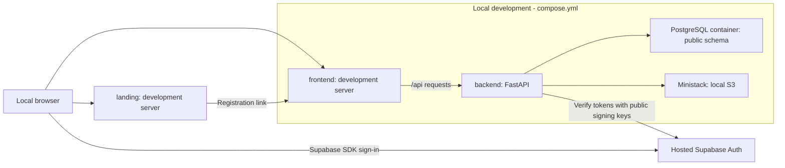
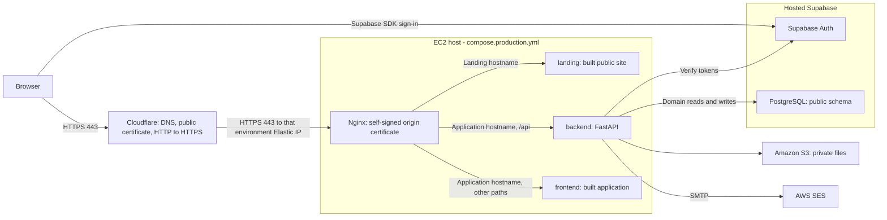
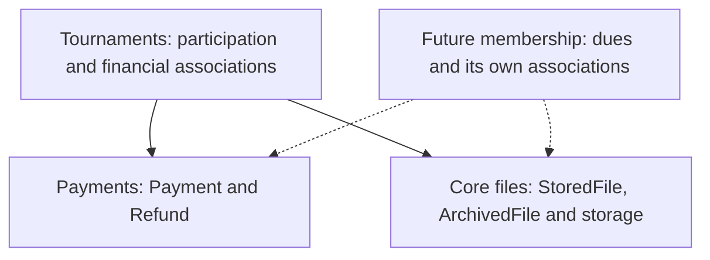

# Architecture

**Created**: 2026-10-17
**Last updated**: 2026-11-04

| Field | Value |
| --- | --- |
| Status | Draft |
| Scope | Application boundaries and explicit local/production stacks |
| Sources | Product-owner overview, registration answers, and stack clarification; [project source map](README.md#project-source-map); source inspection on 17 October 2026 |

## Application boundaries

`landing/` presents Karlbrüder at `karlbruder.com` and links to social channels, event information, and the application. `frontend/` and `backend/` form the application at `app.karlbruder.com`. Prod also answers `prod.karlbruder.com` and `app-prod.karlbruder.com`. Dev answers `dev.karlbruder.com` and `app-dev.karlbruder.com`. All of those names are served by the same Compose project.

The following stacks describe intended architecture, not verified deployments. [Decision 0003](decisions/0003-local-and-production-stacks.md) records the owner's choices. Terms for modes and environments are in the [taxonomy](taxonomy.md).

## Stack comparison

| Responsibility | Development mode | Production mode |
| --- | --- | --- |
| Application stack | `compose.yml`: landing, frontend, backend, PostgreSQL, and Ministack for private files | `compose.production.yml`: Nginx, landing, frontend, and backend on one EC2 host. Both the `dev` and `prod` environments use this file |
| Application entry | Existing development ports and frontend `/api` forwarding | Cloudflare HTTPS edge to EC2 Elastic IP, then Nginx on 443 |
| Identity | Hosted Supabase Auth | Hosted Supabase Auth |
| Domain database | PostgreSQL container, domain objects in `public` | Hosted Supabase PostgreSQL, domain objects in `public`; no PostgreSQL container |
| Private file storage | Ministack S3 emulation in Compose | Amazon S3 |
| Application email | Decision deferred; likely real SES with real AWS/SES credentials | AWS SES via SMTP |

## Local development stack

Local development still uses hosted Supabase for authentication, while domain PostgreSQL runs locally in Docker. The backend writes domain data to the local `public` schema and uses the same verified Supabase user UUIDs as its ownership references. A local domain database does not require a local copy of Supabase's `auth` schema.

Ministack is the chosen local AWS emulator for S3-backed files. Local Compose runs it on port 4566. The backend uses the S3 API in both modes, with a mode-specific endpoint and credentials. Ministack does not replace the explicit PostgreSQL container or Supabase Auth.

## Cloud host

A cloud host runs Nginx, landing, frontend, and backend with `compose.production.yml`. Both `dev` and `prod` are a copy of this diagram. Each copy has its own Elastic IP and its own hostnames, listed in the [taxonomy](taxonomy.md). Supabase supplies hosted PostgreSQL and Auth. S3 and SES are external AWS services for private files and email. There is no PostgreSQL or Ministack container on a cloud host. How an image reaches the host is described in the [deployment spec](platform/deployment.md).

## DNS and HTTPS

Cloudflare nameservers provide authoritative DNS. Prod has proxied A records for `karlbruder.com`, `prod.karlbruder.com`, `app.karlbruder.com`, and `app-prod.karlbruder.com`, all aimed at the prod Elastic IP. Dev has proxied A records for `dev.karlbruder.com` and `app-dev.karlbruder.com`, aimed at the dev Elastic IP. Proxying is required for Cloudflare to handle browser TLS.

There are two TLS connections: the browser connects to Cloudflare using a Cloudflare-managed public certificate, and Cloudflare connects to Nginx on EC2 using HTTPS on 443 with the instance's self-signed certificate. For this self-signed origin design, Cloudflare uses **Full** encryption mode. Browser HTTP on port 80 redirects to HTTPS on 443 at the Cloudflare edge, so EC2 does not need a public HTTP listener.

A DNS-only record skips Cloudflare TLS. The browser then sees the self-signed origin certificate and reports the site as not secure. Flexible mode targets origin port 80, which stays closed. Full (strict) requires a certificate Cloudflare can validate, which this self-signed origin certificate is not.

Only Nginx publishes an application port on a cloud host, 443. Backend and frontend services are reachable through the Compose network and do not publish host ports. The existing local ports remain development configuration rather than a new product decision.

Nginx reads the Host header. A landing name goes to the landing container. An application name sends `/api` to the backend and every other path to the frontend. After a landing, frontend, or backend container is replaced, the deploy starts the edge Nginx container again so it looks up the new address.

## Guild staff access

Guild staff (admins) have full application access across all tournaments, including payment review, private proofs, safety information, exports, and results management when those features exist. There are no event-specific admin grants or additional application roles. Full administrative access does not waive domain constraints such as capacity limits or change the separate AWS team-access policy.

The backend checks a trusted admin role. Choosing its storage representation is an implementation task, not another product permission-model question. User-editable profile metadata cannot grant the role.

## Application request routing

- Requests to the application origin at `/api` or under `/api/` go to the backend. The `/api` prefix is preserved, matching backend routes such as `/api/users/me`.
- Other application-origin requests go to the frontend container. Frontend routes such as `/tournaments/registration` must work on direct navigation and refresh.
- An unknown API route stays a backend response; it must not fall through to frontend SPA HTML.
- Supabase SDK requests go to the configured Supabase Auth service. The application-origin routing rule does not proxy all external authentication traffic through Nginx.
- In local development, forwarding from the development server must preserve the same browser-facing `/api` contract. A separate local Nginx container is not required by this decision.

## Rules

- **ARCH-001:** The backend owns domain validation, authorization, and domain database access. UI validation improves usability but is not authoritative.
- **ARCH-002:** The frontend uses Supabase Auth for identity and sends the session access token to protected backend endpoints. Browser code does not access domain PostgreSQL directly.
- **ARCH-003:** Supabase owns authentication records. Karlbrüder owns tournament and association records in `public`. Application authorization is distinct from successful authentication.
- **ARCH-004:** Users register only themselves. A registration references the existing Supabase `auth.users.id` UUID from the verified token subject, not email or a new tournament-specific user identity. A registration number is a reference, not an access credential.
- **ARCH-005:** Payment proofs and other private uploaded files use Amazon S3 in production and Ministack S3 emulation locally. All access remains authorization-controlled. Private files are not public landing assets or Supabase Storage objects.
- **ARCH-006:** Tournament rules and data are event-scoped. Monomachia branding and configuration do not define the behavior of every tournament.
- **ARCH-007:** Local and deployed configurations use the same domain logic. Environment settings choose database and integration destinations.
- **ARCH-008:** AWS team access uses a separate identity flow from application users. AWS SSO does not grant tournament administration privileges.
- **ARCH-009:** Both modes use hosted Supabase Auth. Development mode stores domain data in Docker PostgreSQL. Production mode stores domain data in Supabase PostgreSQL. Both store application domain objects in `public` and leave managed `auth` objects unchanged.
- **ARCH-010:** `compose.production.yml` contains Nginx, landing, frontend, and backend. Only Nginx publishes a host port, 443. Landing, frontend, and backend stay on the Compose network. Production mode does not include a PostgreSQL container. The `dev` and `prod` environments both use this file.
- **ARCH-011:** Nginx sends `/api` and `/api/...` to the backend without removing the prefix; other application requests go to the frontend. Internal service ports do not define separate browser-facing application URLs.
- **ARCH-012:** The backend sends application email using AWS SES through SMTP. Credentials and SMTP settings belong in backend configuration, not browser code. The local setup is deferred; the owner's likely direction is to use real SES with real AWS/SES credentials locally as well.
- **ARCH-013:** Ministack is a local Compose service for private file storage. It is not a production dependency.
- **ARCH-014:** Guild staff (admins) have full application access globally. No event-specific admin assignment is required. Regular users and guild members retain their existing role boundaries.
- **ARCH-015:** Production uses Cloudflare nameservers and proxied A records for the landing and application names, each aimed at that environment's EC2 Elastic IP. Cloudflare manages browser-facing TLS and the HTTP-to-HTTPS redirect. It connects to Nginx over HTTPS 443 using the origin's self-signed certificate and Full encryption mode.

## Conceptual domain

| Concept | Responsibility |
| --- | --- |
| Authenticated identity | Supabase subject identifying the caller |
| Tournament | Event information, registration windows, and capacity configuration |
| Registration | Athlete information for a tournament, registration number, owner, and lifecycle |
| Payment evidence and review | Restricted proof and guild staff payment decision associated with a registration |
| Consent record | Versioned terms and explicit participant choices |
| Results | Tournament outcomes available to authorized viewers after publication |
| Membership, future | Association membership and monthly dues, independent of tournaments |
| Equipment, future | Admin-only guild inventory of equipment, type, quantity, and condition; no loans or tournament reservations |

Shared file infrastructure lives in `app/core/files/`: StoredFile owns object
metadata, and ArchivedFile records immutable captured content. Source URLs are optional
so a consuming domain can archive an uploaded document too.
Tournaments owns TournamentRegistration, TournamentRegistrationDocument,
RegistrationAcceptance, TournamentPaymentSettings, PaymentProofReview,
RegistrationPayment and RegistrationRefund. The last two are associations to
shared Payment and Refund records owned by payments. Domain associations
control file purpose and access. Generic file metadata grants no access by itself.
Settings, submitted proof, evidence decision, actual receipt, participation and
refund progress remain separate facts. See the [tournament API guide](../backend/app/tournaments/README.md).

Dependency arrows below mean “uses”. Shared code contains no reverse domain
imports or tournament/member foreign keys. Future membership links are illustrative,
not an implemented capability.

These concepts do not prescribe one table per concept. Issue #20 provides a starting schema, not a complete schema for every future workflow.

## Observed implementation baseline

Source inspection on 4 November 2026 established the following implementation baseline. It does not verify live deployments or runtime integrations.

- `backend/app/api/` owns router assembly, HTTP exception mappings, health/metadata endpoints, and shared HTTP helpers. It owns no business rules or domain models. `backend/app/main.py` creates FastAPI and configures middleware, documentation, and database lifespan. `backend/app/core/db/` provides the timestamped model base and sync/async engine/session factories. Existing domain workflows use synchronous sessions. Swagger UI, its redirect helper, and OpenAPI live at `/api/docs`, `/api/docs/oauth2-redirect`, and `/api/openapi.json`. ReDoc is disabled. Health routes and checks are grouped in `backend/app/api/health/`.
- `backend/app/auth/` owns verified identities, token services, route dependencies, and auth exception definitions. Its router exposes `GET /api/users/me`. Domain exceptions remain with their owners and are translated into HTTP responses by the API package.
- `frontend/src/app/router.tsx` mounts account sign-in, sign-up, confirmation, recovery, and password-change routes, the authenticated home, and tournament registration. The auth feature uses Supabase for Google and email/password authentication, session restoration, and sign-out.
- `landing/src/App.js` serves the homepage and `/monomachia`. Tournament registration and private document handling live in the application.
- Local Compose runs landing, frontend, backend, PostgreSQL, and Ministack. The frontend uses Vite on 5173 for serving, health checks, and `/api` forwarding to the backend. The API prefix is preserved. Local Compose runs no Nginx service. See [local development](platform/local-development.md#observed-configuration-and-gaps) for configuration details and remaining gaps.
- Production Compose uses the separate `nginx` service to send application `/api` requests directly to the backend, preserving the prefix. Other application requests go to the frontend image, whose own Nginx serves the built assets. The API path does not pass through the frontend container.
- Health and metadata endpoints are documented in the [backend README](../backend/README.md#diagnostics). Frontend production build configuration is documented in the [frontend README](../frontend/README.md#configuration).
- Tournament registration, private uploads, preserved policies, acceptance snapshots, and financial evidence records are implemented. Staff payment-review and refund commands remain future work. The [tournament API guide](../backend/app/tournaments/README.md) describes the implemented routes and persistence boundaries.
- The payment-instructions read currently returns 404 to an admin who does not own the registration. This differs from the global admin-access requirement in ARCH-014 and AUTH-008. The API guide describes the implemented restriction. It does not establish a product-policy exception.
- Application CI runs in Docker. The deployment workflow targets `dev` on qualifying pushes to `master`. Workflow and rollout details belong in the [deployment spec](platform/deployment.md). Backend application email through SES SMTP remains intended architecture.

## Acceptance criteria

- **ARCH-AC-001:** A non-admin user cannot read another user's private registration record or mutate it by changing a request identifier. The limited participant-directory projection follows PRIV-006; admins retain their authorized global access.
- **ARCH-AC-002:** A signed-in user without the admin role cannot perform administrative actions.
- **ARCH-AC-003:** Switching supported domain database destinations changes configuration rather than business-rule implementations.
- **ARCH-AC-004:** Public website assets and responses contain no private registration records or payment proofs.
- **ARCH-AC-005:** Local authentication uses hosted Supabase while domain reads/writes target Docker PostgreSQL's `public` schema. Production authentication and domain persistence use the configured hosted Supabase project.
- **ARCH-AC-006:** The implemented production Compose stack has Nginx, landing, frontend, and backend, and no PostgreSQL service. A landing hostname reaches the public site. `/api/users/me` reaches the backend unchanged, and frontend deep links reach the frontend.
- **ARCH-AC-007:** The same application storage logic writes to Ministack locally and Amazon S3 in production through environment configuration.
- **ARCH-AC-008:** The production application sends required email through the configured AWS SES SMTP endpoint without exposing SMTP credentials to the browser.
- **ARCH-AC-009:** An authenticated guild admin can administer any tournament without an event-specific grant; regular users and non-admin members cannot perform administrative actions.
- **ARCH-AC-010:** A browser HTTP request redirects to HTTPS at Cloudflare, browser TLS uses the Cloudflare-managed certificate, and the origin connection uses HTTPS 443 with the self-signed Nginx certificate. Backend and frontend have no published production host ports.

## Decisions and deferred work

The questions from this architecture round are resolved: admins have global access, Cloudflare manages public TLS/DNS, Nginx serves the HTTPS origin, and local development retains its existing default ports. Role storage and forwarding configuration are implementation details rather than additional product questions.

How `frontend/src` is organized is [decision 0006](decisions/0006-frontend-application-structure.md). That decision does not change the service boundaries in this document.

The shared file/archive boundary and future reuse are explained in
[decision 0008](decisions/0008-shared-files-and-archives.md).
Shared financial facts and domain associations are explained in
[decision 0009](decisions/0009-shared-payments-and-domain-associations.md).
The database evidence guards, their alternatives and their maintenance costs are
explained in [decision 0010](decisions/0010-database-evidence-guards.md).

Local SMTP setup is explicitly deferred, with real SES as the likely choice. See [identity](identity/authentication-and-access.md), [data storage](platform/data-storage.md), and [deployment](platform/deployment.md) for the related rules.

## Service reference

[Ministack's official repository](https://github.com/ministackorg/ministack) documents a local AWS emulator with S3 support and AWS SDK endpoint configuration. Its [LocalStack migration guide](https://www.ministack.org/docs/migrating-from-localstack) documents compatibility. This architecture selects Ministack itself, not LocalStack or MinIO. The SMTP development setup must be verified separately rather than inferred from SES API emulation.

Cloudflare documents [Full mode for self-signed origin certificates](https://developers.cloudflare.com/ssl/origin-configuration/ssl-modes/full/), [edge HTTP-to-HTTPS redirects](https://developers.cloudflare.com/ssl/edge-certificates/additional-options/always-use-https/), and [proxied DNS records](https://developers.cloudflare.com/dns/proxy-status/). Full mode encrypts the origin connection without validating its certificate; the self-signed certificate here is an origin certificate, not the public certificate presented to visitors.
