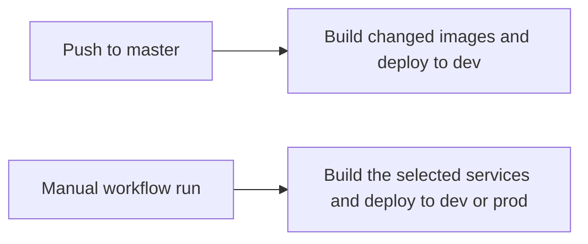

# Deployment

**Created**: 2026-10-17
**Last updated**: 2026-11-01

| Field | Value |
| --- | --- |
| Status | Draft |
| Scope | Production Compose stack on one EC2 host, and how that stack is deployed |
| Applications | landing, frontend, backend, AWS, Supabase |
| Sources | Product-owner stack clarification; [decision 0003](../decisions/0003-local-and-production-stacks.md); [#11](https://github.com/karlbruder/karlbruder_monorepo/issues/11), [#12](https://github.com/karlbruder/karlbruder_monorepo/issues/12), [#25](https://github.com/karlbruder/karlbruder_monorepo/issues/25), [#13](https://github.com/karlbruder/karlbruder_monorepo/issues/13), [#23](https://github.com/karlbruder/karlbruder_monorepo/issues/23), [#42](https://github.com/karlbruder/karlbruder_monorepo/issues/42); private frontend deployment draft |

## Goal

Host the public website and application through clear, verifiable deployment paths while keeping temporary setup stages distinct from the intended later architecture.

## Shared rules

- **DEP-001:** Production infrastructure belongs in the Karlbrüder AWS account. The landing account-migration issue moves hosting away from a personal account.
- **DEP-002:** Both cloud environments run production mode through `compose.production.yml`, containing Nginx, landing, frontend, and backend containers. Supabase supplies hosted Auth and PostgreSQL. Domain data uses `public`. There is no PostgreSQL container in production mode.
- **DEP-003:** Human access, application credentials, and workflow credentials have separate responsibilities. Use authorized secret/configuration mechanisms. Never commit cloud or database credentials.
- **DEP-004:** Prod answers the landing names `karlbruder.com` and `prod.karlbruder.com`, and the application names `app.karlbruder.com` and `app-prod.karlbruder.com`. Dev answers `dev.karlbruder.com` for the landing site and `app-dev.karlbruder.com` for the application. Nginx sends a landing name to the landing container. It sends `/api` and `/api/...` on an application name to the backend unchanged, and every other application request to the frontend container. Frontend deep links and Supabase callbacks must work through this entry point.
- **DEP-005:** Cloudflare nameservers serve DNS. Each public name above is a proxied A record to that environment's EC2 Elastic IP. Cloudflare manages public TLS and redirects HTTP 80 to HTTPS 443. The origin uses a self-signed certificate on Nginx with HTTPS 443 and Cloudflare Full mode. A test environment is required before live operation.
- **DEP-006:** A deploy verification checks the expected application release and relevant API/database behavior. Artifact publication alone does not verify deployment.
- **DEP-007:** Application file storage uses Amazon S3. Application email uses AWS SES via SMTP. Configure backend access to these services; the local Ministack emulator is not a production service.
- **DEP-008:** Only Nginx publishes a production application host port: 443. The frontend and backend communicate over the Compose network and do not publish host ports. Port 80 redirection happens at Cloudflare, preserving the HTTPS-only EC2 origin.

## Production Compose topology

The complete application stack is defined by `compose.production.yml`:

| Component | Responsibility |
| --- | --- |
| Nginx container | HTTPS origin on published port 443 with a self-signed certificate. Landing hostnames go to the landing container. On an application hostname, `/api` goes to the backend and other requests go to the frontend |
| Landing container | Serves the built public site, including SPA route fallback, on an internal Compose port |
| Frontend container | Serves the built application, including SPA route fallback, on an internal Compose port |
| Backend container | FastAPI domain logic, authorization, persistence, file access, and email on an internal Compose port |
| Hosted Supabase | Supabase Auth plus PostgreSQL with domain records in `public` and managed identity in `auth` |
| Amazon S3 | Restricted application files and payment proofs |
| AWS SES SMTP | Application notification delivery |
| Cloudflare | Authoritative DNS, proxied A records for the landing and application names to that environment's Elastic IP, edge TLS certificate, and HTTP-to-HTTPS redirect |

Landing, Nginx, frontend, and backend are the Compose services. Cloudflare terminates browser TLS and opens a separate HTTPS connection to Nginx. For the specified self-signed origin certificate, use [Cloudflare Full mode](https://developers.cloudflare.com/ssl/origin-configuration/ssl-modes/full/) with the [edge HTTPS redirect](https://developers.cloudflare.com/ssl/edge-certificates/additional-options/always-use-https/). This keeps EC2 ingress on 443 only.

`compose.production.yml` is in the repository. Nginx publishes 443, generates a self-signed origin certificate on first start, and keeps the other services on the Compose network. The edge container reads `LANDING_SERVER_NAMES` and `APP_SERVER_NAMES` when it starts and writes those names into its config. Prod sets `karlbruder.com prod.karlbruder.com` and `app.karlbruder.com app-prod.karlbruder.com`. Dev sets `dev.karlbruder.com` and `app-dev.karlbruder.com`. Cloudflare routing for those names is still separate work. The deploy workflow requests them after the host is up.

## Public website

The public site is the landing container on the same host. A landing-only change builds that image and replaces that container. The edge Nginx container is started again so it looks up the new container address. Landing CI still builds relevant pull requests. A live DNS check is not claimed by this description.

Issue #11 still covers moving Cloudflare routing onto the Karlbrüder account and retiring the old public host. The landing files themselves are no longer a separate bucket. Issue #12 has no body, so requirements beyond its title are not reconstructed from it.

## Terraform workspaces

Workload Terraform lives in `infra/`. It accepts the `dev` and `prod` workspaces only. Any other workspace, including `default`, fails the plan. The region is `us-east-2`.

The project name is `karlbruder`. The project slug is `kb`. Both are locals, because they stay the same in every environment. The workspace name is the environment. Workload resource names use `<project-slug>-<env>-<component>`.

Each workload resource carries these tags. There is no `environment` tag. `env` already says `dev` or `prod`. A second tag named `environment` would read as the development or production mode and mix the two words.

| Tag | Value |
| --- | --- |
| `author` | `Terraform` |
| `scope` | `regional` |
| `env` | `dev` or `prod` |
| `project-name` | `karlbruder` |
| `project-slug` | `kb` |
| `repo` | `karlbruder/karlbruder_monorepo` |

Remote state for this root is `kb-terraform-976083331699-us-east-2-an` in `us-east-2`. The state key is `monorepo.tfstate`. `dev` state is `dev/monorepo.tfstate`. `prod` state is `prod/monorepo.tfstate`. Locking uses the S3 lock file. Both workspaces share this bucket, because the backend block cannot select a different bucket per workspace.

## Application host

Each workspace has one EC2 instance in the account default VPC, on the first default subnet, with an Elastic IP. The image is the latest Ubuntu 24.04 LTS build for x86_64 from Canonical. `dev` uses `t3a.micro`. `prod` uses `t3a.small`. The instance name is `kb-<env>-application-host`.

The root volume is encrypted gp3, 30 GiB, 3000 IOPS, and 125 MiB/s. The volume stays if the instance is terminated. AWS Backup is not configured for this host.

Inbound traffic is TCP 443 from the Cloudflare IPv4 ranges in `infra/modules/ec2-instance/locals.tf`. Port 22 and port 80 stay closed. There is no SSH key pair. Day to day access is Session Manager. The instance profile attaches `AmazonSSMManagedInstanceCore` and `CloudWatchAgentServerPolicy`. Instance metadata requires IMDSv2, and the response hop limit is 1, so a container on the Docker bridge cannot read the instance role.

Outbound traffic is DNS on UDP and TCP 53, HTTP on TCP 80 for Ubuntu package mirrors, HTTPS on TCP 443, Supabase Postgres on TCP 5432 and 6543, SES SMTP on TCP 587, and NTP on UDP 123.

First boot installs the CloudWatch agent, Docker Engine, and the Compose plugin. It creates `/opt/karlbruder`. CloudWatch alarms cover high and critical CPU, memory, and root disk usage, plus a failed status check. The agent publishes CPU, memory, and disk every 60 seconds, and those alarms use that interval. The status check also uses a one minute period. Basic EC2 monitoring still publishes hypervisor CPU every five minutes. These alarms do not use that metric. Those alarms do not notify an SNS topic yet. Refresh `cloudflare_ipv4_cidrs` from [Cloudflare's IPv4 list](https://www.cloudflare.com/ips-v4) when Cloudflare publishes a change.

A newer Ubuntu AMI, or an edit to the bootstrap script, does not replace a running instance. Replacing the image or the script is a deliberate change.

## Application image deploy

Each workspace has four ECR repositories: `kb-<env>/landing`, `kb-<env>/frontend`, `kb-<env>/backend`, and `kb-<env>/nginx`. The instance role can pull only those repositories. `compose.production.yml` names the images with `AWS_ACCOUNT_ID`, `AWS_REGION`, `NAMESPACE`, and `IMAGE_TAG`. `IMAGE_TAG` is the git SHA of the release. The workflow also moves the `dev` or `prod` tag on each image it builds. That moving tag is only the last build of that service. The host runs the SHA. For a service this run did not build, the workflow copies the moving tag onto the release SHA before the host pulls. The backend reads `/opt/karlbruder/backend.env` when Compose runs from `/opt/karlbruder`. The workflow does not create or upload that file. That file must set `SECRET_NAME` to `kb-<env>/backend` and `AWS_REGION` to `us-east-2`. Cloud startup reads that secret and fails when either value is missing. Terraform creates the secret and lets the instance role call `secretsmanager:GetSecretValue` on it. Terraform does not write the secret value. Put the backend settings JSON in that secret after apply. The secret uses the AWS managed key, so the role does not need a separate decrypt permission.

GitHub Actions assumes one role, `KbGithubActionsRole`, through GitHub OIDC. Terraform does not create that role or the account OIDC provider. Create the provider once, at `https://token.actions.githubusercontent.com`, with audience `sts.amazonaws.com`. Then create the role. Build, stamp, and deploy all use it, for both `dev` and `prod`.

A token carries one `sub` value. The jobs in this workflow set a GitHub environment, so the token subject is `environment:dev` or `environment:prod`. The trust policy allows both.

```json
{
  "Version": "2012-10-17",
  "Statement": [
    {
      "Effect": "Allow",
      "Principal": {
        "Federated": "arn:aws:iam::976083331699:oidc-provider/token.actions.githubusercontent.com"
      },
      "Action": "sts:AssumeRoleWithWebIdentity",
      "Condition": {
        "StringEquals": {
          "token.actions.githubusercontent.com:aud": "sts.amazonaws.com"
        },
        "StringLike": {
          "token.actions.githubusercontent.com:sub": [
            "repo:karlbruder/karlbruder_monorepo:environment:dev",
            "repo:karlbruder/karlbruder_monorepo:environment:prod"
          ]
        }
      }
    }
  ]
}
```

The same role pushes images and sends the deploy command. It can push to the eight application repositories, describe instances, send `AWS-RunShellScript` to `kb-dev-application-host` and `kb-prod-application-host`, and read that command result.

```json
{
  "Version": "2012-10-17",
  "Statement": [
    {
      "Sid": "EcrGetAuthorizationToken",
      "Effect": "Allow",
      "Action": ["ecr:GetAuthorizationToken"],
      "Resource": "*"
    },
    {
      "Sid": "EcrPush",
      "Effect": "Allow",
      "Action": [
        "ecr:BatchCheckLayerAvailability",
        "ecr:BatchGetImage",
        "ecr:CompleteLayerUpload",
        "ecr:DescribeImages",
        "ecr:DescribeRepositories",
        "ecr:GetDownloadUrlForLayer",
        "ecr:InitiateLayerUpload",
        "ecr:PutImage",
        "ecr:UploadLayerPart"
      ],
      "Resource": [
        "arn:aws:ecr:us-east-2:976083331699:repository/kb-dev/landing",
        "arn:aws:ecr:us-east-2:976083331699:repository/kb-dev/frontend",
        "arn:aws:ecr:us-east-2:976083331699:repository/kb-dev/backend",
        "arn:aws:ecr:us-east-2:976083331699:repository/kb-dev/nginx",
        "arn:aws:ecr:us-east-2:976083331699:repository/kb-prod/landing",
        "arn:aws:ecr:us-east-2:976083331699:repository/kb-prod/frontend",
        "arn:aws:ecr:us-east-2:976083331699:repository/kb-prod/backend",
        "arn:aws:ecr:us-east-2:976083331699:repository/kb-prod/nginx"
      ]
    },
    {
      "Sid": "DescribeApplicationHost",
      "Effect": "Allow",
      "Action": ["ec2:DescribeInstances"],
      "Resource": "*"
    },
    {
      "Sid": "SendCommandToApplicationHost",
      "Effect": "Allow",
      "Action": ["ssm:SendCommand"],
      "Resource": "arn:aws:ec2:us-east-2:976083331699:instance/*",
      "Condition": {
        "StringEquals": {
          "ssm:resourceTag/Name": [
            "kb-dev-application-host",
            "kb-prod-application-host"
          ]
        }
      }
    },
    {
      "Sid": "UseRunShellScriptDocument",
      "Effect": "Allow",
      "Action": ["ssm:SendCommand"],
      "Resource": "arn:aws:ssm:us-east-2::document/AWS-RunShellScript"
    },
    {
      "Sid": "ReadCommandResult",
      "Effect": "Allow",
      "Action": ["ssm:GetCommandInvocation"],
      "Resource": "*"
    }
  ]
}
```

A push to `master` deploys the `dev` environment. It does not deploy `prod`. The workflow uses `dorny/paths-filter` v4 and builds the services whose files changed. A change to `compose.production.yml` or the deploy workflow builds all four. A manual run can deploy `dev` or `prod`, for one service or for all of them. The dev landing image is built with `https://app-dev.karlbruder.com`. The prod landing image is built with `https://app.karlbruder.com`. The dev frontend image is built with the `dev` GitHub environment secrets `VITE_SUPABASE_URL` and `VITE_SUPABASE_PUBLISHABLE_KEY`. The prod frontend image uses the secrets of the same names on the `prod` environment. The URL is a Docker build argument. The publishable key is passed through a BuildKit secret mount and is still public in the browser bundle. The workflow rebuilds the frontend builder stage so key rotation cannot reuse an old bundle from cache. Vite rejects legacy JWT keys and server-only secret keys. Vite owns the required frontend variable check for both direct and Docker builds. It fails with the missing variable names when either value is empty or whitespace. `VITE_API_BASE_URL` remains optional and defaults to `/api`. The pipeline generates one UTC `RELEASED_AT` timestamp per run. Backend, frontend, and landing production stages store that timestamp and `GIT_SHA` in the image environment. Reused images retain their original build metadata when retagged for another deployment. A container restart does not change the embedded build timestamp. The host pulls the release SHA for every service, replaces the stack, and starts the edge Nginx container again. Both hosts run production mode from `compose.production.yml`. There is no zip or SCP deploy path. After the host reports success, the workflow requests the landing origin, the application origin, and `/api/health`. That health request must return 200. It also requests `/api/metadata`. When the run built the backend, `git_sha` on that response must equal the commit and `released_at` must equal the pipeline build timestamp. This check follows the public Cloudflare names, so it fails until those names resolve.



## Supabase browser access

Use `sb_publishable_...` keys for browser Auth. Configure `VITE_SUPABASE_PUBLISHABLE_KEY` in the local frontend environment and in each GitHub deployment environment. Never supply `sb_secret_...` or legacy `service_role` keys to the frontend.

The application accesses domain data through FastAPI and its direct PostgreSQL connection. Disable the Supabase Data API in both cloud environments. Review existing and default grants on domain tables for `anon` and `authenticated`. Any deliberately exposed data requires explicit grants and appropriate Row Level Security policies. These hosted settings require live verification and are not applied by this workflow.

Issue a publishable key before deploying the renamed setting. After all consumers migrate, disable legacy API keys separately. Disabling the Data API does not mean disabling the publishable key used for Auth.

## Earlier deployment issues and reconciliation

The earlier issues describe deployment transport evolution. Their backend-only topology and older Compose filename are historical inputs superseded by decision 0003. These issue bodies have not been changed, and their deployed state has not been verified.

| Source | Earlier delivery plan | Reconciliation needed |
| --- | --- | --- |
| #25 | Initial EC2 host with zip/SCP, interactive access, and build/start on host | Deploy the Nginx, landing, frontend, and backend stack in `compose.production.yml` rather than a backend-only service |
| #13, depends on #25 | Session Manager replaces day-to-day inbound SSH; zip/build-on-host remains | Verify managed file transfer and remote execution for the combined stack |
| #23, depends on #13 | Build/push backend image to ECR; host pulls and restarts through Session Manager | The deploy workflow builds the changed images among landing, frontend, backend, and Nginx, then replaces those containers through Session Manager. A live run is still unverified |
| Private frontend hosting draft | S3 hosting versus hosting beside the backend | Resolved in favor of the frontend container behind the application Nginx proxy |

Issue #23's image deploy is the workflow in this spec. It replaces the zip and build-on-host path. Migration and failed-release recovery are still open. The workflow now requests the public names after deploy, and that request still needs DNS and Cloudflare to be in place. Earlier HTTP-only host setup is not the finished HTTPS application deployment. Host egress includes SES SMTP on TCP 587 and Ubuntu package mirrors on TCP 80.

## Acceptance criteria

- **DEP-AC-001:** After landing migration, deployment publishes to the intended organizational target and public routing serves that target correctly before the old hosting is retired.
- **DEP-AC-002:** The implemented `compose.production.yml` runs Nginx, landing, frontend, and backend without PostgreSQL or Ministack containers. The backend uses Supabase PostgreSQL's `public` schema.
- **DEP-AC-003:** When the ECR deployment from issue #23 is delivered, a workflow publishes the application image, the host runs it through the managed deployment path, the combined application stack responds, and the superseded zip/build path is removed.
- **DEP-AC-004:** In a released frontend environment, a refreshed deep link and an authentication callback return to the expected application and API paths.
- **DEP-AC-005:** Before live participant-data collection, HTTPS, restricted proof access, and the agreed pre-production verification are in place.
- **DEP-AC-006:** `/api/users/me` reaches the backend with the full path preserved, while a refresh on `/tournaments/registration` reaches the frontend. Unknown API routes are not served as SPA HTML.
- **DEP-AC-007:** The deployed application uses S3 for its files and AWS SES SMTP for application emails, with the required backend configuration.
- **DEP-AC-008:** Application HTTP redirects to HTTPS at Cloudflare. The proxied A record's origin target is the EC2 Elastic IP, and Cloudflare reaches the self-signed Nginx origin over HTTPS 443. Production Compose publishes no frontend/backend host ports.

## Open questions

None about the selected stack, domains, application routing, DNS, or TLS. The remaining engineering and operational work is preserved below; it does not require repeating those product decisions.

## Implementation and operations decisions

- Verify which rollout stage is actually deployed. Source inspection and historical issue status are not evidence of the live AWS configuration.
- Define workflow credentials, triggers, environment separation, artifact delivery, and production configuration in the deployment plan, following the [team-access credential policy](team-access.md#implementation-and-operations-decisions).
- Define migration execution, release verification, failed-release recovery, and database/object backup-and-restore procedures. Apply PRIV-011's interim indefinite-retention policy rather than defining another period here.
- Verify the concrete Session Manager file-transfer, remote-execution, and networking setup for the selected combined stack.
- Define and verify the landing account/DNS cutover and rollback procedure before retiring the old hosting.

## Related specifications

[Architecture](../architecture.md), [local development](local-development.md), [data storage](data-storage.md), [team access](team-access.md), [privacy](../tournaments/consent-and-privacy.md), [operational runbooks](../../docs/runbooks/README.md).
